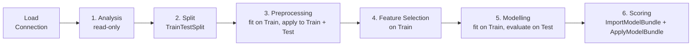

# koco Guide

How to go from a raw table to a scored regression or binary classification model with koco.

- [Life cycle](#life-cycle)
- [Input requirements](#input-requirements)
- [Small examples](#small-examples)
- [End-to-end example](#end-to-end-example)
- [What the functions return](#what-the-functions-return)
- [Creating an outlier plan](#creating-an-outlier-plan)
- [Function reference](#function-reference)
- [Algorithm keys](#algorithm-keys)
- [Guides](#guides)
- [Output files and messages](#output-files-and-messages)
- [SQL Server configuration](#sql-server-configuration)

---

## Life cycle



| Step | Goal | Functions |
|---|---|---|
| 1. Analysis | Understand the data, spot nulls, outliers and data errors. Nothing is changed. | `DataSummary`, `DrawChart`, `AggregationReport`, `ColumnBinning`, `SampleBinning`, `CrossCheck`, `OutlierReport`, `OutlierCountByVariable`, `TargetDivergenceByColumn` |
| 2. Split | Hold out a Test sample **before** fitting anything, so no Test information leaks into the plans. | `TrainTestSplit`, `RepresentationReport` (does Train represent the population?) |
| 3. Preprocessing | Follow Null → Outlier → WOE → Scaling, skipping steps that are not needed. WOE is for binary models only. Fit or choose the plans on Train, then apply them unchanged to Train, Test and production. | `ProfileNullColumns`, `FitNullPlan`, `ApplyNullPlan`, `ApplyOutlierPlan`, `FitWOEPlan`, `ApplyWOEPlan`, `FitScalingPlan`, `ApplyScalingPlan`, `ExportJson`, `ImportJson` |
| 4. Feature Selection | Remove redundant and uninformative features. | `Correlation`, `VIFReport`, `SelectModelFeatures`, `BackwardSelection` |
| 5. Modelling | Train several algorithms, compare them, evaluate on Test. | `ModelRegistryGuide`, `CheckModellingInputs`, `RegressionModelling`, `ClassificationModelling`, `ApplyModel`, `CalculateModelPredictions`, `RegressionMetrics`, `ClassificationMetrics`, `MetricGuide`, `ExportModelArtifacts`, `ExportModelBundle` |
| 6. Scoring | Apply the saved plans and the chosen model to new data. | `ImportModelBundle`, `ApplyModelBundle` (or `ImportJson`, `ApplyNullPlan`, `ApplyOutlierPlan`, `ApplyWOEPlan`, `ApplyScalingPlan`, `ApplyModel`, `CalculateModelPredictions` one by one) |

Rules of thumb:

- Feature selection and modelling need **numeric** features. koco does not provide categorical encoding. Encode text columns with another tool before these steps, or exclude them explicitly from `Features`; keep the same encoding at scoring time.
- Fit every plan on **Train only**, then apply the same plan to Test and to production data.
- Keep the preprocessing order the same everywhere: Null → Outlier → WOE → Scaling. Skip steps that are not needed; WOE is for binary models only and often needs no additional scaling.
- Scaling-sensitive algorithms (linear models, SVM, KNN, MLP) expect scaled features; tree models do not need scaling. Use `ScalingMethodGuide` to choose a scaling method.
- The `Apply*` functions do not modify their input table. Columns that are not changed share memory with the input, so they are cheap on large tables.

---

## Input requirements

- Pass a non-empty pandas DataFrame with unique column names.
- `Target` identifies a numeric column. Regression requires at least two distinct non-null target values. Binary classification requires numeric `0` and `1`; Boolean targets should be converted to integers.
- `Features` is a non-empty list of distinct numeric column names and must exclude `Target`. Exclude identifiers and other unsuitable columns explicitly. When `Features=None`, modelling uses every column except `Target`.
- Target and feature columns must not contain positive or negative infinity.
- The modelling functions exclude rows with a missing target and record a warning. Other functions may have different missing-value requirements.
- Handle missing feature values before feature selection. For modelling, remaining NaNs are accepted only by algorithms that support them; inspect `ModelRegistryGuide` and `Log`.
- Binary training data must contain both classes. Sample-size requirements depend on the function, model and split; there is no single minimum for the whole library.
- Scoring requires the training feature names and the same preprocessing. The target column is not required for prediction.

---

## Small examples

These examples use generated data and core dependencies only: no database or optional algorithms.
Run the setup first, then either modelling example. Set the random seed to reproduce the data.

### Shared setup

```python
import numpy as np
import pandas as pd
import koco

Random = np.random.default_rng(1234)
Income = Random.uniform(2000, 8000, 240)
Age = Random.integers(20, 70, 240).astype(float)
Table = pd.DataFrame({
    "Income": Income,
    "Age": Age,
    "Amount": 0.2 * Income + 10 * Age + Random.normal(0, 50, 240),
    "Default": (Income + Random.normal(0, 1200, 240) < 4500).astype(int),
})
Table.loc[::12, "Income"] = np.nan
Features = ["Income", "Age"]
```

### Regression without a database

```python
Train, Test = koco.TrainTestSplit(
    Table, Target="Amount", TestSize=0.25, RandomState=1234,
)
NullPlan, Check = koco.FitNullPlan(Train, [("Income", "Median")])
Train = koco.ApplyNullPlan(Train, NullPlan, Verbose=False)
Test = koco.ApplyNullPlan(Test, NullPlan, Verbose=False)

Artifacts, Performance, Log, TrainData = koco.RegressionModelling(
    Train, Models=["LinearR"], Target="Amount", Features=Features,
    Split=False, RandomState=1234,
)
print(Log)
Prediction = koco.ApplyModel(Test, Artifacts["LinearR"])
print(koco.RegressionMetrics(Test["Amount"], Prediction))
```

`Prediction` is a Series with the same index as `Test`. `Performance` describes Train here because
`Split=False`; the final call evaluates the held-out Test sample.

### Binary classification without a database

```python
Train, Test = koco.TrainTestSplit(
    Table, Target="Default", TestSize=0.25, RandomState=1234, StratifyClasses=True,
)
NullPlan, Check = koco.FitNullPlan(Train, [("Income", "Median")])
Train = koco.ApplyNullPlan(Train, NullPlan, Verbose=False)
Test = koco.ApplyNullPlan(Test, NullPlan, Verbose=False)
ScalePlan = koco.FitScalingPlan(Train, {"Standardization": Features})
Train = koco.ApplyScalingPlan(Train, ScalePlan)
Test = koco.ApplyScalingPlan(Test, ScalePlan)

Artifacts, Performance, Log, TrainData = koco.ClassificationModelling(
    Train, Models=["LogisticC"], Target="Default", Features=Features,
    Split=False, RandomState=1234, Threshold=0.5,
)
print(Log)
Scores = koco.ApplyModel(Test, Artifacts["LogisticC"])
print(Scores.head())  # Probability and Prediction
print(koco.ClassificationMetrics(Test["Default"], Scores["Probability"], Threshold=0.5))
```

Each example fits its own plans on its own Train split. An explicit feature list excludes the other
target column from training.

---

## End-to-end example

The following workflow illustrates a larger SQL-backed project. It assumes numeric `Income`, `Age`
and `Score` columns, a text `Segment` column, an `OldFlag` column to drop, and the chosen target.
The SQL setup is described in [SQL Server configuration](#sql-server-configuration).
Optional algorithms require their extras; inspect `Log` for skipped algorithms or failed fits.

### Regression

```python
import pandas as pd
import koco

# 0. Load
Engine = koco.Connection("SERVER_A", "MyDatabase")
Table = pd.read_sql("SELECT * FROM dbo.Customer", Engine)
Target = "Amount"

# 1. Analysis (full data, read-only)
Summary = koco.DataSummary(Table)
ImagePath = koco.DrawChart(Table, BarColumn=Target, BinCount=30, SaveImage=True)   # returns the PNG path
koco.AggregationReport(Table, ["Segment"], Agg={Target: ["mean", "sum"]})
koco.ColumnBinning(Table, "Income", Bins=[0, 5000, 10000, 50000, 1e9])
koco.CrossCheck(Table, {"NegativeAge": "Age < 0", "MissingIncome": "Income IS NULL", "VipText": "Segment = 'A AND B'"})
koco.OutlierReport(Table, Method="IQR")
koco.OutlierCountByVariable(Table, "Income", Thresholds=[("Cap", 250000)])
koco.TargetDivergenceByColumn(Table, Target, "Segment")   # default: at least 1000 rows per segment

# 2. Split first
Train, Test = koco.TrainTestSplit(Table, Target, TestSize=0.3, StratifyBins=10)
koco.RepresentationReport(Table, Train)                   # does Train represent the whole population?

# 3. Preprocessing: fit on Train, apply to both
koco.NullStrategyGuide(Print=True)
koco.ProfileNullColumns(Train)                      # FilePath="Data/NullAnalysis" also exports it to Excel
NullPlan, NullCheck = koco.FitNullPlan(Train, [("Income", "Median"), ("Age", "Mean"), ("Score", "FixValue", 0), ("OldFlag", "Drop")])
Train = koco.ApplyNullPlan(Train, NullPlan)
Test  = koco.ApplyNullPlan(Test, NullPlan)

OutlierPlan = {"Columns": {"Income": ["U", 250000], "Age": ["L", 18]}}
Train = koco.ApplyOutlierPlan(Train, OutlierPlan)
Test  = koco.ApplyOutlierPlan(Test, OutlierPlan)

koco.ScalingMethodGuide(Print=True)
ScalePlan = koco.FitScalingPlan(Train, {"Standardization": ["Age"], "Robust": ["Income", "Score"]})
Train = koco.ApplyScalingPlan(Train, ScalePlan)
Test  = koco.ApplyScalingPlan(Test, ScalePlan)

koco.ExportJson(NullPlan, "Plans/NullPlan.json")
koco.ExportJson(OutlierPlan, "Plans/OutlierPlan.json")
koco.ExportJson(ScalePlan, "Plans/ScalingPlan.json")

# 4. Feature selection (Train only)
Features = ["Income", "Age", "Score"]
CorrTable, Features, Dropped = koco.Correlation(Train[Features + [Target]], Target, Limit=0.7)
VIF, HighVIF = koco.VIFReport(Train[Features])
Selection = koco.SelectModelFeatures(Train, Features, Target, EliminationMethod="OnlyNoise")
Features = Selection.loc[Selection.Decision == "Select", "Feature"].tolist()

# 5. Modelling: fit on Train, evaluate on the untouched Test
ModelRegistry = koco.ModelRegistryGuide("Regression")
Artifacts, Performance, Log, TrainData = koco.RegressionModelling(
    Train, ["LinearR", "RidgeR", "RandFR", "LGBMR"], Target, Features=Features, Split=False,
)
TestPerformance = pd.DataFrame([
    {"AlgorithmName": Key, **koco.RegressionMetrics(Test[Target], koco.ApplyModel(Test, Artifact))}
    for Key, Artifact in Artifacts.items()
])

# 6. Scoring new data: one file carries the model and its plans
BundlePath, BundleHash = koco.ExportModelBundle(
    Artifacts["RandFR"], Plans={"Null": NullPlan, "Outlier": OutlierPlan, "Scaling": ScalePlan}, FilePath="Models/AmountModel.joblib",
)
Bundle = koco.ImportModelBundle(BundlePath, ExpectedHash=BundleHash)     # in production
NewData = pd.read_sql("SELECT * FROM dbo.NewCustomer", Engine)
NewData["Prediction"] = koco.ApplyModelBundle(NewData, Bundle)           # Null -> Outlier -> WOE -> Scaling -> model
```

The plans are optional, and `ApplyModelBundle` applies only what the bundle holds. Store every plan
actually used to prepare the model's training features. A tree model can be trained without
scaling, but if it was trained on scaled data, its scoring bundle also needs that scaling plan.
Without a bundle, load the plans with `ImportJson` and call `ApplyNullPlan`, `ApplyOutlierPlan`, `ApplyWOEPlan`, `ApplyScalingPlan` and `ApplyModel` yourself, in this order (leave out the plans you did not fit).

> To reuse models in another session, save them with
> `koco.ExportModelArtifacts(Artifacts, "Amount models", "Models/Artifacts")` and load one with
> `koco.ImportJoblib("Models/Artifacts/RandFR.joblib")`. A `Manifest.json` with package versions is written next to them.
> To save the entire artifacts dictionary in one file, use
> `koco.ExportJoblib(Artifacts, "Models/Artifacts.joblib")` and reload it with
> `Artifacts = koco.ImportJoblib("Models/Artifacts.joblib")`. Only load trusted joblib files.

### Binary classification

Use a fresh split and refit the plans for the binary target; plans from the regression split are
not reused. This example uses numeric features only, leaving `Segment` out of modelling.

```python
Target = "Default"
Train, Test = koco.TrainTestSplit(Table, Target, TestSize=0.3, StratifyClasses=True)
Features = ["Income", "Age", "Score"]
NullPlan, NullCheck = koco.FitNullPlan(Train, [("Income", "Median"), ("Age", "Mean"), ("Score", "FixValue", 0), ("OldFlag", "Drop")])
Train = koco.ApplyNullPlan(Train, NullPlan)
Test = koco.ApplyNullPlan(Test, NullPlan)
OutlierPlan = {"Columns": {"Income": ["U", 250000], "Age": ["L", 18]}}
Train = koco.ApplyOutlierPlan(Train, OutlierPlan)
Test = koco.ApplyOutlierPlan(Test, OutlierPlan)
ScalePlan = koco.FitScalingPlan(Train, {"Standardization": Features})
Train = koco.ApplyScalingPlan(Train, ScalePlan)
Test = koco.ApplyScalingPlan(Test, ScalePlan)
Selection = koco.SelectModelFeatures(Train, Features, Target, ModelType="Binary")
Features = Selection.loc[Selection.Decision == "Select", "Feature"].tolist()

Artifacts, Performance, Log, TrainData = koco.ClassificationModelling(
    Train, ["LogisticC", "RandFC", "LGBMC"], Target, Features=Features, Split=False, ClassWeight="balanced",
)
Scores = koco.ApplyModel(Test, Artifacts["LGBMC"])                      # Probability + Prediction
koco.ClassificationMetrics(Test[Target], Scores["Probability"], Artifacts["LGBMC"]["Threshold"])
```

#### Optional: WOE binning and backward selection (binary models, e.g. scorecards)

This is an alternative branch of the binary workflow: start immediately after null handling and
outlier capping, before fitting or applying scaling or running the modelling block above.

```python
# After the null and outlier plans, before scaling. Fit on Train only.
WOEPlan, Binning, IVTable = koco.FitWOEPlan(Train, Target, Features=Features, CoverBound=0.01, MeanDiffBound=0.01, IVBound=0.02)
Train = koco.ApplyWOEPlan(Train, WOEPlan)       # adds <Feature>_Bin and <Feature>_WOE
Test  = koco.ApplyWOEPlan(Test, WOEPlan)
koco.ExportJson(WOEPlan, "Plans/WOEPlan.json")

WOEFeatures = [f"{Column}_WOE" for Column in WOEPlan["Columns"]]
if not WOEFeatures:
    raise ValueError("WOE selected no features. Review IVTable and the binning settings before modelling.")
Kept, Steps = koco.BackwardSelection(Train, Target, Features=WOEFeatures, MaxPValue=0.05, ModelType="Binary")
Artifacts, Performance, Log, TrainData = koco.ClassificationModelling(Train, ["LogisticC"], Target, Features=Kept, Split=False)

koco.ExportModelBundle(Artifacts["LogisticC"], {"Null": NullPlan, "Outlier": OutlierPlan, "WOE": WOEPlan}, "Models/Scorecard.joblib")
```

- Bins are built from the distinct values of the event rows and merged until each covers more than `CoverBound` of the rows and neighbouring event rates differ by more than `MeanDiffBound`. Nulls form their own bin (a very small null group joins the bin with the closest event rate).
- `IVTable` lists every feature with its Information Value and `Selection`; `Binning` lists every bin with its WOE, IV and `BinClass`.
- A bin with no events or no non-events would have an infinite WOE; `ZeroAdjustment` (default 0.5) replaces the zero count so the plan stays finite and JSON-safe.
- WOE columns are already on a comparable scale, so a scaling plan is usually not needed after `ApplyWOEPlan`.

---

## What the functions return

The function reference gives the signature, every parameter and the return value for each public
function. The main objects used across the workflow are:

| Object | Structure | Next step |
|---|---|---|
| Null plan | `FitNullPlan` returns `(Plan, Check)`: a dict with a `Columns` dict, plus a validation DataFrame. | Apply `Plan` with `ApplyNullPlan`; review `Check`. |
| Scaling plan | `FitScalingPlan` returns a dict with per-column `Strategy`, `Offset` and `Scale`. | `ApplyScalingPlan` |
| WOE outputs | `FitWOEPlan` returns `(Plan, Binning, IVTable)`. The plan contains selected features; the other two outputs are DataFrames. | Review binning and selection before `ApplyWOEPlan`. |
| Modelling outputs | Both modelling functions return `(Artifacts, Performance, Log, TrainData)`. | Inspect the tables and score with an entry from `Artifacts`. |
| Model bundle export | `ExportModelBundle` returns `(FilePath, Hash)`: a `pathlib.Path` and a SHA-256 string. | Keep the hash separately and pass it as `ExpectedHash` when importing. |
| Model bundle import | `ImportModelBundle` returns a dict containing `Artifact`, `Plans` and metadata. | `ApplyModelBundle` |

### Modelling outputs and artifacts

- `Artifacts` is a dict keyed by the algorithms that fitted successfully, for example
  `Artifacts["RandFR"]`. An unavailable or failed algorithm may be absent; inspect `Log` before
  accessing an entry.
- `Performance` is a DataFrame with one row per evaluated algorithm and sample. With `Split=False`,
  only Train is evaluated internally; evaluate an external Test sample separately.
- `Log` records validation messages, warnings and failures. Its columns are `Label`, `AlgorithmName`,
  `SampleName`, `Stage`, `Severity`, `Message` and `SystemDate`.
- `TrainData` contains the exact training rows, retaining their original index, with `Features`
  and `Target` columns.

Each artifact contains:

| Key | Meaning |
|---|---|
| `Model` | Fitted estimator |
| `ModelType` | `"Regression"` or `"Binary"` |
| `Algorithm` | Estimator class name |
| `Features` | Ordered list of feature names used for training |
| `Target` | Target column name |
| `Params` | Parameters supplied to the estimator |
| `Threshold` | Binary probability cut-off; `None` for regression |
| `Label` | Run label |
| `TrainDate` | Training timestamp |
| `TrainSize` | Number of training rows |

`ImportModelBundle` returns the artifact and plans alongside `BundleFormat`, `KocoVersion`,
`CreatedAt`, `Explanation`, `Environment` and `ModelSha256`. Version checks and hashes do not make
an untrusted file safe: only load joblib files and bundles from trusted sources.

### Prediction outputs

| Function | Regression | Binary classification |
|---|---|---|
| `ApplyModel` | Series named `Prediction` | DataFrame with `Probability` (class 1) and `Prediction` (0/1) |
| `ApplyModelBundle` | Same as `ApplyModel`, after applying stored plans | Same as `ApplyModel`, after applying stored plans |
| `CalculateModelPredictions` | Requested input columns plus one column per algorithm, e.g. `RandFR` | Requested input columns plus `<Key>Probability` and `<Key>Prediction`, e.g. `LogisticCProbability` |

Prediction outputs retain the input index. If a null plan uses `DropRows`, `ApplyModelBundle`
returns only the rows that remain after preprocessing.

## Creating an outlier plan

There is no `FitOutlierPlan` function. The user chooses the limits and creates the plan as a dict.
`OutlierReport` provides statistical candidates; domain rules can be used instead, such as a minimum
age of 18 or an upper income limit of 250000.

For a train-derived upper limit, run this after null handling and before WOE or scaling:

```python
Outliers = koco.OutlierReport(Train[["Income"]], Method="IQR")
IncomeUpper = Outliers.loc[Outliers["Column"] == "Income", "UpperBound"].iloc[0]
if not np.isfinite(IncomeUpper):
    raise ValueError("Income has no finite upper bound; review the training data.")

OutlierPlan = {"Columns": {"Income": ["U", float(IncomeUpper)]}}
Train = koco.ApplyOutlierPlan(Train, OutlierPlan)
Test = koco.ApplyOutlierPlan(Test, OutlierPlan)
koco.ExportJson(OutlierPlan, "Plans/OutlierPlan.json")
```

This snippet uses `numpy as np` from the small examples. Review the reported counts and bounds before
choosing a cap; an IQR bound is a candidate, not an automatic decision to cap every outlier.

- `"U"` caps values above the chosen limit; `"L"` raises values below it.
- Each column entry holds one direction and one limit. To cap both ends of a column, apply separate
  lower and upper plans in a consistent order; a single plan cannot hold duplicate column keys.
- Choose data-derived limits on Train only and reuse them on Test and new data.
- `OutlierReport(..., Method=None)` reports both methods with prefixed names such as `IQRUpperBound`;
  specifying `Method="IQR"` gives the `UpperBound` used in the example.
- `ApplyOutlierPlan` returns a new DataFrame. Assign that result; it does not modify `Train` or
  `Test` in place.

---

## Function reference

The tables provide a quick overview. Expand a function's details for its full signature, parameter
descriptions and return value. Required parameters have no default; `pd` is pandas, `np` is numpy,
`Path` is `pathlib.Path`, `Callable` is a callable type, and `Engine` is a SQLAlchemy engine.
Example calls show the parameters relevant to that example, rather than repeating every default.
The examples in the reference tables are independent snippets, not one sequential script.
Installation commands below install from PyPI. From a source folder, use `".[sql]"` instead of
`"koco-ml[sql]"` and run the command from the folder containing `pyproject.toml`.

### general

| Function | Goal | Example |
|---|---|---|
| `Connection` | Return a SQLAlchemy engine for SQL Server. Needs `python -m pip install "koco-ml[sql]"`; see [SQL Server configuration](#sql-server-configuration). | `Engine = koco.Connection("SERVER_A", "MyDatabase")` or `koco.Connection(Config="sql.json")` |
| `RunFuncInSubSample` | Run any DataFrame-returning function per group and stack the results. | `koco.RunFuncInSubSample(Table, "Segment", koco.DataSummary)` |
| `ExportExcel` | Write several tables and chart images into one Excel workbook (`ExportExcel(Sheets, FilePath)`). Sheets are validated first (names of 1–31 characters, at most 1,048,576 rows per sheet). | `koco.ExportExcel({"Summary": Summary, "Charts": [ImagePath, Table]}, "Report.xlsx")` |
| `ImportExcel` | Read one sheet (name or position, first sheet by default) as a DataFrame, or every sheet as a dict with `SheetName=None`. The first row is the header, as `ExportExcel` writes it. | `Table = koco.ImportExcel("Report.xlsx", "Summary")` |
| `ExportParquet` | Save a DataFrame as Parquet. Needs `pyarrow`. | `koco.ExportParquet(Table, "Data/table.parquet")` |
| `ImportParquet` | Read a DataFrame from a Parquet file. | `Table = koco.ImportParquet("Data/table.parquet")` |
| `ExportJoblib` | Save a dictionary as joblib. | `koco.ExportJoblib(Artifacts, "Artifacts.joblib")` |
| `ImportJoblib` | Load a dictionary from a trusted joblib file. Loading untrusted files can execute arbitrary code. | `Artifacts = koco.ImportJoblib("Artifacts.joblib")` |
| `ExportJson` | Save a dictionary, such as a fitted plan, as JSON. NaN / inf values are rejected. | `koco.ExportJson(ScalePlan, "Plans/ScalingPlan.json")` |
| `ImportJson` | Load a dictionary from a JSON file. The `Apply*` functions validate plans themselves. | `ScalePlan = koco.ImportJson("Plans/ScalingPlan.json")` |
| `ExportModelArtifacts` | Save each model artifact as joblib plus a JSON manifest with package versions in a directory (`DirPath`, default: current folder). | `koco.ExportModelArtifacts(Artifacts, "Amount models", "Models/Artifacts")` |
| `ExportModelBundle` | Save one model and its plans (`Null`, `Outlier`, `WOE`, `Scaling`, all optional) in a single joblib file; returns the path and the SHA-256 of the file. | `FilePath, Hash = koco.ExportModelBundle(Artifacts["RandFR"], {"Scaling": ScalePlan}, "Models/Amount.joblib")` |
| `ImportModelBundle` | Load a bundle, check the digest of the file (`ExpectedHash`) and of the model inside, and warn about version differences. Load trusted files only. | `Bundle = koco.ImportModelBundle(FilePath, ExpectedHash=Hash)` |

<details>
<summary>Connection: parameters and return value</summary>

```text
Connection(
    Server: str | None = None,
    Database: str | None = None,
    Config: str | Path | None = None,
) -> Engine
```

**Parameters**

- `Server`: Server name. None uses DefaultServer of Config.
- `Database`: Database name. None uses DefaultDatabase of Config.
- `Config`: Path of the JSON configuration file; None uses no file, so Server and Database are required.

**Returns**

SQLAlchemy engine connected to the requested database.

</details>

<details>
<summary>RunFuncInSubSample: parameters and return value</summary>

```text
RunFuncInSubSample(
    Table: pd.DataFrame,
    GroupColumn: str,
    Func: Callable[..., pd.DataFrame],
    **kwargs,
) -> pd.DataFrame
```

**Parameters**

- `Table`: Source table to split into groups.
- `GroupColumn`: Column used to create subgroups.
- `Func`: Function called with each subgroup as its first argument; must return a DataFrame.
- `**kwargs`: Extra keyword arguments passed to Func.

**Returns**

Combined DataFrame with GroupColumn as the first column and one result block per subgroup.

</details>

<details>
<summary>ExportExcel: parameters and return value</summary>

```text
ExportExcel(
    Sheets: dict[str, pd.DataFrame | str | list[pd.DataFrame | str]],
    FilePath: str | Path | None = None,
) -> Path
```

**Parameters**

- `Sheets`: Sheet mapping where each value is a DataFrame, an image path, or a list of them, written top to bottom.
- `FilePath`: Output Excel file. None writes &lt;yymmdd&gt;_ExportExcel.xlsx to the current folder; a path with an extension is the file itself; a folder (existing, or a path without an extension) receives the default file name. Missing folders are created.

**Returns**

Path of the written workbook.

</details>

<details>
<summary>ImportExcel: parameters and return value</summary>

```text
ImportExcel(
    FilePath: str | Path,
    SheetName: str | int | None = 0,
) -> pd.DataFrame | dict[str, pd.DataFrame]
```

**Parameters**

- `FilePath`: Input Excel file (.xlsx or .xlsm).
- `SheetName`: Sheet name or zero-based position of the sheet to read; the first sheet by default. None reads every sheet.

**Returns**

DataFrame of the requested sheet, or a dict of sheet name -&gt; DataFrame when SheetName is None.

</details>

<details>
<summary>ExportParquet: parameters and return value</summary>

```text
ExportParquet(
    Table: pd.DataFrame,
    FilePath: str | Path | None = None,
) -> Path
```

**Parameters**

- `Table`: DataFrame to export.
- `FilePath`: Output file. None writes &lt;yymmdd&gt;_ExportParquet.parquet to the current folder; a path with an extension is the file itself; a folder (existing, or a path without an extension) receives the default file name. Missing folders are created.

**Returns**

Path of the written file; the DataFrame index is not exported.

</details>

<details>
<summary>ImportParquet: parameters and return value</summary>

```text
ImportParquet(
    FilePath: str | Path,
) -> pd.DataFrame
```

**Parameters**

- `FilePath`: Input Parquet file path.

**Returns**

DataFrame read from the file.

</details>

<details>
<summary>ExportJoblib: parameters and return value</summary>

```text
ExportJoblib(
    Data: dict,
    FilePath: str | Path | None = None,
) -> Path
```

**Parameters**

- `Data`: Dictionary to export.
- `FilePath`: Output file. None writes &lt;yymmdd&gt;_ExportJoblib.joblib to the current folder; a path with an extension is the file itself; a folder (existing, or a path without an extension) receives the default file name. Missing folders are created.

**Returns**

Path of the written file.

</details>

<details>
<summary>ImportJoblib: parameters and return value</summary>

```text
ImportJoblib(
    FilePath: str | Path,
) -> dict
```

**Parameters**

- `FilePath`: Input joblib file path.

**Returns**

Dictionary read from the file.

</details>

<details>
<summary>ExportJson: parameters and return value</summary>

```text
ExportJson(
    Data: dict,
    FilePath: str | Path | None = None,
) -> Path
```

**Parameters**

- `Data`: JSON-serializable dictionary to export.
- `FilePath`: Output file. None writes &lt;yymmdd&gt;_ExportJson.json to the current folder; a path with an extension is the file itself; a folder (existing, or a path without an extension) receives the default file name. Missing folders are created.

**Returns**

Path of the written file.

</details>

<details>
<summary>ImportJson: parameters and return value</summary>

```text
ImportJson(
    FilePath: str | Path,
) -> dict
```

**Parameters**

- `FilePath`: Path of a file written by ExportJson.

**Returns**

Dictionary read from the file; the Apply functions validate plans themselves.

</details>

<details>
<summary>ExportModelArtifacts: parameters and return value</summary>

```text
ExportModelArtifacts(
    ModelArtifacts: dict,
    Explanation: str = "Model Artifacts",
    DirPath: str | Path | None = None,
) -> Path
```

**Parameters**

- `ModelArtifacts`: Mapping of algorithm names to fitted artifact dictionaries.
- `Explanation`: Short description recorded in the manifest.
- `DirPath`: Destination directory. None uses the current folder; a missing folder is created.

**Returns**

Path of the directory. It holds one &lt;Algorithm&gt;.joblib file per model and Manifest.json.

</details>

<details>
<summary>ExportModelBundle: parameters and return value</summary>

```text
ExportModelBundle(
    Artifact: dict,
    Plans: dict[str, dict] | None = None,
    FilePath: str | Path | None = None,
    Explanation: str = "Model Bundle",
) -> tuple[Path, str]
```

**Parameters**

- `Artifact`: One entry of the ModelArtifacts dict returned by RegressionModelling or ClassificationModelling, e.g. ModelArtifacts["RandFR"].
- `Plans`: Fitted plans keyed by "Null" (FitNullPlan), "Outlier" (outlier plan), "WOE" (FitWOEPlan) and "Scaling" (FitScalingPlan). All are optional; leave out the plans the model does not need.
- `FilePath`: Output file. None writes &lt;yymmdd&gt;_ExportModelBundle.joblib to the current folder; a path with an extension is the file itself; a folder (existing, or a path without an extension) receives the default file name. Missing folders are created.
- `Explanation`: Short description stored in the bundle.

**Returns**

Tuple of (FilePath, Sha256). Sha256 is the digest of the written file; keep it to verify the file later with ImportModelBundle(ExpectedHash=...).

</details>

<details>
<summary>ImportModelBundle: parameters and return value</summary>

```text
ImportModelBundle(
    FilePath: str | Path,
    ExpectedHash: str | None = None,
) -> dict
```

**Parameters**

- `FilePath`: Path of the bundle file.
- `ExpectedHash`: SHA-256 digest returned by ExportModelBundle. If given, the file is verified before anything is loaded.

**Returns**

Bundle dict with the keys BundleFormat, KocoVersion, CreatedAt, Explanation, Environment, Plans (only the plans that were exported), Artifact (the model artifact including its fitted Model) and ModelSha256. Pass it to ApplyModelBundle.

</details>

### analysis

| Function | Goal | Example |
|---|---|---|
| `AggregationReport` | Group a table and report counts, share and chosen aggregations per group. | `koco.AggregationReport(Table, ["Segment"], Agg={"Income": ["mean"]}, Sort=[("Rate", "Desc")])` |
| `ColumnBinning` | Show the distribution of a numeric column in equal-width or custom ranges. | `koco.ColumnBinning(Table, "Age", Bins=[18, 30, 45, 65, 100])` |
| `SampleBinning` | Split a column into equal-sized bins (deciles by default) with min/max per bin. | `koco.SampleBinning(Table, "Income", Bins=10)` |
| `DataSummary` | Describe every column: type, counts, nulls, percentiles, zero/positive/negative rates. | `Summary = koco.DataSummary(Table)` |
| `CrossCheck` | Count rows matching SQL-like data-quality rules. Quoted text is never rewritten; wrap column names with spaces in backticks. | ``koco.CrossCheck(Table, {"BadAge": "Age < 0 OR Age > 120", "NoIncome": "`Net Income` IS NULL"})`` |
| `OutlierReport` | Report IQR and/or Z-score outlier bounds and counts for every numeric column. | `koco.OutlierReport(Table, Method="IQR")` |
| `OutlierCountByVariable` | Print how many rows lie beyond percentile (P1, P5, P95, P99) or custom thresholds of one column. | `koco.OutlierCountByVariable(Table, "Income", AddStats=True)` |
| `RepresentationReport` | Compare a sample (e.g. Train) with the population column by column and return a representation power `Rep` (1 = identical statistics). `Detail=True` adds the relative difference of each statistic. | `koco.RepresentationReport(Table, Train)` |
| `TargetDivergenceByColumn` | Test (Kruskal-Wallis) whether the target distribution differs across groups. | `koco.TargetDivergenceByColumn(Table, "Amount", "Segment")` |
| `DrawChart` | Draw a histogram, bar, line or bar+line chart; with `SaveImage=True` or a `FilePath` it saves a PNG and returns its path. | `ImagePath = koco.DrawChart(Table, BarColumn="Income", BinCount=30, SaveImage=True)` |

<details>
<summary>AggregationReport: parameters and return value</summary>

```text
AggregationReport(
    Table: pd.DataFrame,
    GroupColumns: list[str],
    Agg: dict[str, str | list[str] | tuple[str, ...]] | None = None,
    Sort: list[tuple[str, str | bool]] | None = None,
) -> pd.DataFrame
```

**Parameters**

- `Table`: Source table to aggregate.
- `GroupColumns`: Columns used for grouping.
- `Agg`: Aggregation mapping such as {"Amount": ["mean", "sum"]}; output columns are named &lt;Func&gt;&lt;Column&gt;, e.g. meanAmount.
- `Sort`: Optional (Column, Direction) tuples; Direction is "Asc" / "Desc" or a bool (True = ascending). Without Sort the report is ordered by Observation descending.

**Returns**

DataFrame containing grouped counts, aggregations, and rate values.

</details>

<details>
<summary>ColumnBinning: parameters and return value</summary>

```text
ColumnBinning(
    Table: pd.DataFrame,
    Column: str,
    Bins: int | tuple[float, float, int] | list[float] | None = None,
) -> pd.DataFrame
```

**Parameters**

- `Table`: Source table containing the target column.
- `Column`: Numeric column to bin.
- `Bins`: None for 10 equal-width bins, an int for that many equal-width bins, a (Start, Stop, Count) tuple for Count equal-width bins between Start and Stop, or a strictly increasing list of int / float edges. Values outside a tuple or list range are not counted.

**Returns**

DataFrame with bin labels, observation counts, and rates. A constant column is reported as a single bin.

</details>

<details>
<summary>SampleBinning: parameters and return value</summary>

```text
SampleBinning(
    Table: pd.DataFrame,
    Column: str,
    Bins: int = 10,
) -> pd.DataFrame
```

**Parameters**

- `Table`: Source table containing the target column.
- `Column`: Column to split into sample-based bins.
- `Bins`: Number of bins to create.

**Returns**

DataFrame with observation counts, min and max values, and rates per bin.

</details>

<details>
<summary>DataSummary: parameters and return value</summary>

```text
DataSummary(
    Table: pd.DataFrame,
) -> pd.DataFrame
```

**Parameters**

- `Table`: Source table to summarize.

**Returns**

DataFrame with one row per column containing type, count, null, and distribution metrics. Numeric statistics are NaN for non-numeric columns.

</details>

<details>
<summary>CrossCheck: parameters and return value</summary>

```text
CrossCheck(
    Table: pd.DataFrame,
    CheckList: dict[str, str],
) -> pd.DataFrame
```

**Parameters**

- `Table`: Source table used for rule evaluation.
- `CheckList`: Mapping of control names to SQL-like rule expressions, e.g. {"NegativeAge": "Age &lt; 0 AND Segment IS NOT NULL"}. Wrap column names that contain spaces in backticks, e.g. "`Net Income` IS NULL".

**Returns**

DataFrame containing each rule and its matching row count.

</details>

<details>
<summary>OutlierReport: parameters and return value</summary>

```text
OutlierReport(
    Table: pd.DataFrame,
    Method: str | None = None,
) -> pd.DataFrame
```

**Parameters**

- `Table`: Source table containing the numeric columns.
- `Method`: None for both methods, "IQR" for the 1.5x IQR rule, or "ZScore" for the |z| &gt; 3 rule.

**Returns**

DataFrame with the bounds, outlier count, and outlier rate per numeric column.

</details>

<details>
<summary>OutlierCountByVariable: parameters and return value</summary>

```text
OutlierCountByVariable(
    Table: pd.DataFrame,
    VariableName: str,
    Thresholds: list[tuple[str, float]] | None = None,
    AddStats: bool = False,
) -> None
```

**Parameters**

- `Table`: Source table containing the numeric column.
- `VariableName`: The name of the variable to analyze.
- `Thresholds`: (Label, Value) pairs to check, e.g. [("Cap", 250000)].
- `AddStats`: Add the statistical thresholds P1, P5, P95, P99 (percentiles), Mode and Median; they are always added when Thresholds is empty.

**Returns**

None. The counts are printed.

</details>

<details>
<summary>RepresentationReport: parameters and return value</summary>

```text
RepresentationReport(
    Population: pd.DataFrame,
    Sample: pd.DataFrame,
    Statistics: list[str] | None = None,
    Detail: bool = False,
) -> pd.DataFrame
```

**Parameters**

- `Population`: Table of the whole population (for example all customers).
- `Sample`: Table of the sample (for example Train).
- `Statistics`: DataSummary statistics to compare, a subset of REPRESENTATION_STATISTICS. None uses AvgValue, ModValue, MedValue, NullRate, ZeroRate, PositiveRate and NegativeRate.
- `Detail`: If True, the relative difference of every statistic is returned as well.

**Returns**

DataFrame sorted by Rep descending with ColumnName, Rep and, when Detail is True, one column per statistic. Rep is 1 for identical statistics and gets smaller as they diverge (it can be negative). The mean Rep of all columns is printed as the representation power of the sample.

</details>

<details>
<summary>TargetDivergenceByColumn: parameters and return value</summary>

```text
TargetDivergenceByColumn(
    Table: pd.DataFrame,
    Target: str,
    Divergence: str,
    Alpha: float = 0.05,
    EffectThreshold: float = 0.01,
    MinObservationSize: int = 1000,
) -> dict
```

**Parameters**

- `Table`: Source table containing the target and grouping columns.
- `Target`: Numeric target column whose distributions are compared.
- `Divergence`: Column defining the groups to compare.
- `Alpha`: Significance level for the p-value, between 0 and 1.
- `EffectThreshold`: Minimum epsilon-squared effect size for a practical difference.
- `MinObservationSize`: Minimum number of observations required in every group.

**Returns**

Dict with the keys:

- `Statistic`: Kruskal-Wallis H statistic.

- `PValue`: Probability of a difference at least this large arising by chance.

- `EpsilonSquared`: Effect size of the difference.

- `GroupCount`: Number of groups compared.

- `ObservationCount`: Number of rows used in the test.

- `GroupSizes`: Observation count per group.

- `Significant`: PValue &lt; Alpha.

- `Divergent`: True when both the significance and the effect size conditions are met.

</details>

<details>
<summary>DrawChart: parameters and return value</summary>

```text
DrawChart(
    Table: pd.DataFrame,
    BarColumn: str | None = None,
    BinCount: int | None = None,
    LineColumn: str | None = None,
    IndexColumn: str | None = None,
    Title: str | None = None,
    FigureSize: tuple[float, float] = (5, 3),  # (11, 6) for presentations
    DPI: int = 100,  # 150 for presentations
    SaveImage: bool = False,
    FilePath: str | Path | None = None,
) -> str | None
```

**Parameters**

- `Table`: Source table containing the chart data.
- `BarColumn`: Column plotted as bars or histogram.
- `BinCount`: Bin count used for numeric histograms.
- `LineColumn`: Column plotted as a line.
- `IndexColumn`: Optional column used as the x-axis.
- `Title`: Optional chart title.
- `FigureSize`: Figure size in inches as width and height.
- `DPI`: Figure resolution.
- `SaveImage`: Whether to save the chart as a PNG file; saving also happens when FilePath is given.
- `FilePath`: Image file. None saves &lt;yymmdd&gt;_DrawChart.png to the current folder; a path with an extension is the file itself; a folder (existing, or a path without an extension) receives the default file name. Missing folders are created.

**Returns**

Path of the saved PNG file (usable in ExportExcel), or None when the chart is not saved. The chart is displayed and its figure is closed afterwards.

</details>

### preprocessing

| Function | Goal | Example |
|---|---|---|
| `ProfileNullColumns` | Profile only the columns with nulls to help choose a strategy per column. Exports to Excel only when `FilePath` is given (a folder receives `<yymmdd>_NullProfile.xlsx`). | `koco.ProfileNullColumns(Train, FilePath="Data/NullAnalysis")` |
| `FitNullPlan` | Calculate fill values on Train and return a reusable null plan plus a validation table. Rules are validated before anything is printed. | `NullPlan, Check = koco.FitNullPlan(Train, [("Income", "Median")])` |
| `ApplyNullPlan` | Apply a fitted null plan (drop / fill) to any table. `DropRows` keeps the index; `NaNHandling="Safe"` also drops `KeepNaN` columns; `Verbose=False` silences it. | `Test = koco.ApplyNullPlan(Test, NullPlan)` |
| `FitWOEPlan` | Binary targets only. Bin each numeric feature, calculate WOE / IV and fit a plan of the features with IV above `IVBound`. Returns the plan, the full binning table and the IV table. Fit on Train only. | `WOEPlan, Binning, IVTable = koco.FitWOEPlan(Train, "Default", Features=Features, CoverBound=0.01, MeanDiffBound=0.01, IVBound=0.02)` |
| `ApplyWOEPlan` | Add `<Feature>_Bin` and `<Feature>_WOE` columns for the planned features to any table. Nulls unseen in Train get Bin 0 and WOE 0. | `Test = koco.ApplyWOEPlan(Test, WOEPlan)` |
| `ApplyOutlierPlan` | Cap values above (`"U"`) or below (`"L"`) fixed limits. Unknown methods and missing columns are reported and skipped. | `Train = koco.ApplyOutlierPlan(Train, {"Columns": {"Income": ["U", 250000]}})` |
| `FitScalingPlan` | Fit Standardization / Normalization / Robust / MaxAbs parameters on Train (see `ScalingMethodGuide`). | `ScalePlan = koco.FitScalingPlan(Train, {"Robust": ["Income"]})` |
| `ApplyScalingPlan` | Apply a fitted scaling plan to any table. Entries are validated (`Scale` must not be 0) and the columns must be numeric. | `Test = koco.ApplyScalingPlan(Test, ScalePlan)` |

<details>
<summary>ProfileNullColumns: parameters and return value</summary>

```text
ProfileNullColumns(
    Table: pd.DataFrame,
    FilePath: str | Path | None = None,
) -> pd.DataFrame
```

**Parameters**

- `Table`: Source table to inspect for null values.
- `FilePath`: None does not export. A path with an extension (e.g. "Data/NullAnalysis/Profile.xlsx") is the Excel file itself; a folder (existing, or a path without an extension, e.g. "Data/NullAnalysis") receives &lt;yymmdd&gt;_NullProfile.xlsx. Missing folders are created.

**Returns**

DataFrame with the null-relevant statistics, empty if no column contains nulls.

</details>

<details>
<summary>FitNullPlan: parameters and return value</summary>

```text
FitNullPlan(
    Table: pd.DataFrame,
    NullPlan: list[tuple[str, str] | tuple[str, str, int | float | str]],
) -> tuple[dict, pd.DataFrame]
```

**Parameters**

- `Table`: Training table the fill values are calculated from.
- `NullPlan`: Rules like [("A", "Drop"), ("B", "Median"), ("D", "FixValue", 10)]; see NullStrategyGuide.

**Returns**

Tuple of (FittedPlan, ColumnValidation).

- `FittedPlan`: JSON-serializable dict {"Columns": {Column: {"Strategy", "Value"}}}.

- `ColumnValidation`: DataFrame listing columns with nulls missing from NullPlan, plan columns not found in Table (skipped), and plan columns without nulls in Table (still fitted).

</details>

<details>
<summary>ApplyNullPlan: parameters and return value</summary>

```text
ApplyNullPlan(
    Table: pd.DataFrame,
    Plan: dict,
    NaNHandling: str = "Full",
    Verbose: bool = True,
) -> pd.DataFrame
```

**Parameters**

- `Table`: Source table the plan is applied to.
- `Plan`: Null plan produced by FitNullPlan or loaded with ImportJson.
- `NaNHandling`: "Full" leaves KeepNaN columns untouched, "Safe" drops them for a NaN-free result.
- `Verbose`: If False, nothing is printed (useful for scoring and loops).

**Returns**

New DataFrame with the plan applied; Table itself is not modified. DropRows keeps the original index so removed rows can be traced back.

</details>

<details>
<summary>FitWOEPlan: parameters and return value</summary>

```text
FitWOEPlan(
    Table: pd.DataFrame,
    Target: str,
    Features: list[str] | None = None,
    CoverBound: float = 0.01,
    MeanDiffBound: float = 0.01,
    IVBound: float = 0.02,
    ZeroAdjustment: float = 0.5,
) -> tuple[dict, pd.DataFrame, pd.DataFrame]
```

**Parameters**

- `Table`: Training table; fit it on Train only. Features must be numeric and finite, and the Target must contain only 0 and 1 without nulls.
- `Target`: Binary target column.
- `Features`: Features to bin. If None, every column except Target is used.
- `CoverBound`: Minimum share of the rows a bin must cover, between 0 and 1.
- `MeanDiffBound`: Minimum difference between the event rates of neighbouring bins.
- `IVBound`: A feature is selected when its IV is above this value.
- `ZeroAdjustment`: Count used instead of 0 when a bin has no events or no non-events, so that WOE and IV stay finite. Bins without zero counts are not affected.

**Returns**

Tuple of (Plan, Binning, FeatureSelection).

- `Plan`: JSON-serializable {"Columns": {Feature: {"Cuts", "Bins", "WOE", "NullBin", "NullWOE"}}} of the selected features only. Interval j covers (Cuts[j - 1], Cuts[j]], the first one has no lower bound and the last one no upper bound. Apply it with ApplyWOEPlan.

- `Binning`: One row per bin of every feature with ColumnName, Bin, LowerBound, UpperBound, Coverage, Rate, Freq, Target, NonTarget, BinFreq, BinTarget, BinNonTarget, BinPercTarget, BinPercNonTarget, WOE, IV and BinClass. A merged null group appears as an extra row with the Bin of the bin it joined.

- `FeatureSelection`: ColumnName, IV and Selection (1 if IV &gt; IVBound) sorted by IV descending.

</details>

<details>
<summary>ApplyWOEPlan: parameters and return value</summary>

```text
ApplyWOEPlan(
    Table: pd.DataFrame,
    Plan: dict,
) -> pd.DataFrame
```

**Parameters**

- `Table`: Source table containing the planned features.
- `Plan`: WOE plan produced by FitWOEPlan or loaded with ImportJson.

**Returns**

New DataFrame with the original columns plus &lt;Feature&gt;_Bin and &lt;Feature&gt;_WOE for each planned feature; Table itself is not modified.

</details>

<details>
<summary>ApplyOutlierPlan: parameters and return value</summary>

```text
ApplyOutlierPlan(
    Table: pd.DataFrame,
    Plan: dict,
) -> pd.DataFrame
```

**Parameters**

- `Table`: Source table the limits are applied to.
- `Plan`: Plan such as {"Columns": {"Income": ["U", 250000], "Age": ["L", 18]}}. "U" caps values above the limit, "L" raises values below the limit. Columns missing in Table and methods other than "U" / "L" are reported and skipped.

**Returns**

New DataFrame with the limits applied; Table itself is not modified.

</details>

<details>
<summary>FitScalingPlan: parameters and return value</summary>

```text
FitScalingPlan(
    Table: pd.DataFrame,
    Scaling: dict[str, list[str]],
) -> dict
```

**Parameters**

- `Table`: Training table the scaling parameters are calculated from; it is not modified.
- `Scaling`: Mapping of scaling methods to their column names, e.g. {"Standardization": ["Age"], "Robust": ["Income"]}.

**Returns**

Fitted plan {"Columns": {Column: {"Strategy", "Offset", "Scale"}}}. Apply it to Train, Test or production data with ApplyScalingPlan and save it with ExportJson.

</details>

<details>
<summary>ApplyScalingPlan: parameters and return value</summary>

```text
ApplyScalingPlan(
    Table: pd.DataFrame,
    Plan: dict,
) -> pd.DataFrame
```

**Parameters**

- `Table`: Source table the fitted plan is applied to.
- `Plan`: Scaling plan produced by FitScalingPlan or loaded with ImportJson.

**Returns**

New DataFrame scaled with the parameters fitted on the training data; Table is not modified.

</details>

### feature_selection

| Function | Goal | Example |
|---|---|---|
| `Correlation` | Find highly correlated feature pairs and drop the one weaker with the target (vectorized, fast with many columns). | `Corr, Keep, Drop = koco.Correlation(Train[Features + [Target]], Target, Limit=0.7)` |
| `BackwardSelection` | Backward elimination: refit OLS (`ModelType="Regression"`) or Logit (`"Binary"`) and drop the feature with the highest p-value until all are at most `MaxPValue`. Returns the kept features and a table of the removal steps. Needs `python -m pip install "koco-ml[stats]"`. | `Kept, Steps = koco.BackwardSelection(Train, Target, Features=Features, MaxPValue=0.05, ModelType="Binary")` |
| `VIFReport` | Measure multicollinearity (VIF) and list features above `Threshold` (default 10). Bool columns are treated as 0/1. | `VIF, High = koco.VIFReport(Train[Features], Threshold=5)` |
| `SelectModelFeatures` | Keep features that beat random noise probes on permutation importance + mutual information. `EliminationMethod="Combined"` uses the blended rank score; `"OnlyNoise"` (stricter) needs both raw signals to beat the best probe. | `koco.SelectModelFeatures(Train, Features, Target, ModelType="Binary", EliminationMethod="OnlyNoise")` |

<details>
<summary>Correlation: parameters and return value</summary>

```text
Correlation(
    Table: pd.DataFrame,
    Target: str,
    Limit: float = 0.6,
    Method: str = "pearson",
    MethodT: str = "pearson",
) -> tuple[pd.DataFrame, list[str], list[str]]
```

**Parameters**

- `Table`: Source table containing only numeric feature columns and Target.
- `Target`: Target column used to compare correlated features.
- `Limit`: Absolute correlation threshold for elimination.
- `Method`: Correlation method for feature-to-feature comparison ("pearson", "spearman", "kendall").
- `MethodT`: Correlation method for feature-to-target comparison.

**Returns**

Tuple of (CorrelationTable, RemainingColumns, EliminatedColumns).

</details>

<details>
<summary>BackwardSelection: parameters and return value</summary>

```text
BackwardSelection(
    Table: pd.DataFrame,
    Target: str,
    Features: list[str] | None = None,
    MaxPValue: float = 0.05,
    ModelType: str = "Regression",
) -> tuple[list[str], pd.DataFrame]
```

**Parameters**

- `Table`: Source table containing the Target and the Features, null-free; scale or encode the features before calling it when the model needs it.
- `Target`: Numeric target column; 0/1 for Binary.
- `Features`: Candidate numeric feature names. If None, every column except Target is used.
- `MaxPValue`: Largest p-value a feature may have to stay, between 0 and 1.
- `ModelType`: "Regression" (OLS) or "Binary" (Logit).

**Returns**

Tuple of (RemainingFeatures, Steps).

- `RemainingFeatures`: Kept features sorted by p-value, smallest first; empty if none passes.

- `Steps`: One row per removal with Step, RemovedFeature, PValue and Remaining (number of features left after the removal).

</details>

<details>
<summary>VIFReport: parameters and return value</summary>

```text
VIFReport(
    Table: pd.DataFrame,
    Target: str | None = None,
    AutoClean: bool = False,
    Threshold: float = 10,
) -> tuple[pd.DataFrame, list[str]]
```

**Parameters**

- `Table`: Source table containing the feature columns; bool columns are treated as 0/1.
- `Target`: Optional target column excluded from the report.
- `AutoClean`: When True, drop non-numeric and constant columns and rows with null or inf values before the calculation; when False, raise an error if any are found.
- `Threshold`: Features with a VIF above this value are listed as high VIF features.

**Returns**

Tuple of (Report, HighVIFFeatures); HighVIFFeatures lists features with VIF above Threshold.

</details>

<details>
<summary>SelectModelFeatures: parameters and return value</summary>

```text
SelectModelFeatures(
    Table: pd.DataFrame,
    Features: list[str],
    Target: str,
    Models: str | list[str] | None = None,
    Scoring: str | None = None,
    NNoiseFeatures: int = 10,
    CVFolds: int = 5,
    NRepeats: int = 10,
    RandomState: int = 1234,
    MinSelect: int = 1,
    ModelType: str = "Regression",
    EliminationMethod: str = "Combined",
    NJobs: int | None = -1,
) -> pd.DataFrame
```

**Parameters**

- `Table`: Source table containing the candidate feature and Target columns, already null-free and scaled by the caller; this function does not transform the data.
- `Features`: Candidate numeric feature names to evaluate.
- `Target`: Target column name; numeric for Regression, 0/1 for Binary.
- `Models`: One or more registry keys of ModelType used to score importance; using more than one model reduces the risk of a single algorithm's bias driving the decision. None uses ("LassoR", "RandFR") for Regression and ("LogisticC", "RandFC") for Binary.
- `Scoring`: sklearn scoring string used by permutation_importance. None uses "r2" for Regression and "roc_auc" for Binary.
- `NNoiseFeatures`: Number of random noise-probe columns used as the elimination baseline. More probes give a stricter and more stable baseline: a useless feature beats all probes with a probability of about 1 / (NNoiseFeatures + 1).
- `CVFolds`: Number of cross-validation folds (stratified for Binary).
- `NRepeats`: Number of shuffles per fold used by permutation_importance.
- `RandomState`: Seed controlling noise generation, CV splits, and model fitting.
- `MinSelect`: Minimum number of features to keep; the best-ranked eliminated features are reprieved if fewer than this many pass the noise baseline.
- `ModelType`: "Regression" or "Binary".
- `EliminationMethod`: "Combined" selects a feature when its CombinedScore (average percentile rank of both signals) is above the best noise probe. "OnlyNoise" is stricter: the permutation importance (above 0) and the mutual information must both be above the best noise probe in raw values.
- `NJobs`: Parallel jobs of the permutation importance; models that already run in parallel use NJobs for themselves and permute sequentially to avoid nested parallelism.

**Returns**

Report DataFrame sorted by CombinedScore descending, covering both the real Features and the noise-probe rows (flagged via IsNoiseProbe) so the baselines stay auditable. Columns: Feature, IsNoiseProbe, PermutationImportance, MutualInfo, CombinedScore (0-100 scale), NoiseThreshold (best probe CombinedScore), PermutationNoiseThreshold, MutualInfoNoiseThreshold, Decision ("Select"/"Eliminate"/"Noise"), and Reason (populated for Eliminate/Noise rows only). Filter on Decision to get the two groups, e.g. Report.loc[Report.Decision == "Select", "Feature"].

</details>

### modelling

| Function | Goal | Example |
|---|---|---|
| `CheckModellingInputs` | Validate modelling inputs and list which algorithms can run (called automatically). Typos in `ModelParams` of `**kwargs` estimators (XGB, LGBM) are logged as warnings. | `Runnable, Log = koco.CheckModellingInputs(Train, ["RandFR"], Target)` |
| `TrainTestSplit` | Split into Train/Test, optionally stratified on target bins or classes. | `Train, Test = koco.TrainTestSplit(Table, Target, StratifyBins=10)` |
| `RegressionModelling` | Train several regression algorithms and return artifacts, performance and a log. | `koco.RegressionModelling(Train, ["RidgeR", "RandFR"], Target, Split=False)` |
| `ClassificationModelling` | Train several binary classifiers with optional class weights and auto threshold. | `koco.ClassificationModelling(Train, ["LogisticC", "LGBMC"], Target, ClassWeight="balanced")` |

<details>
<summary>CheckModellingInputs: parameters and return value</summary>

```text
CheckModellingInputs(
    Table: pd.DataFrame,
    Models: str | list[str],
    Target: str,
    Features: list[str] | None = None,
    Label: str | None = None,
    Split: dict | bool | None = None,
    ModelParams: dict[str, dict] | None = None,
    RandomState: int = 1234,
    ModelType: str = "Regression",
    ClassWeight: str | dict | None = None,
    Threshold: str | float = "auto",
) -> tuple[list[str], pd.DataFrame]
```

**Parameters**

- `Table`: Modelling table containing the Target and Features columns.
- `Models`: One or more keys of the registry that belongs to ModelType.
- `Target`: Numeric target column name; for Binary it must contain only 0 and 1.
- `Features`: Feature column names. If None, every column except Target is used.
- `Label`: Run label written to the log.
- `Split`: False uses the full Table as Train; a dict provides split parameters. None enables splitting with defaults. Allowed keys: TestSize, RandomState, Shuffle and StratifyBins (Regression) or StratifyClasses (Binary).
- `ModelParams`: Algorithm specific parameters, e.g. {"RandFR": {"n_estimators": 500}}.
- `RandomState`: Seed applied to every algorithm that supports one.
- `ModelType`: "Regression" or "Binary".
- `ClassWeight`: Binary only. None, "balanced" or a dict such as {0: 1, 1: 5}.
- `Threshold`: Binary only. "auto" or a number between 0 and 1.

**Returns**

Tuple of (RunnableModels, Log).

- `RunnableModels`: Model keys that passed validation, in the requested order.

- `Log`: DataFrame with columns Label, AlgorithmName, SampleName, Stage, Severity, Message, SystemDate. Severity is Error for skipped algorithms and Warning otherwise.

</details>

<details>
<summary>TrainTestSplit: parameters and return value</summary>

```text
TrainTestSplit(
    Table: pd.DataFrame,
    Target: str,
    TestSize: float = 0.3,
    RandomState: int = 1234,
    Shuffle: bool = True,
    StratifyBins: int | None = None,
    StratifyClasses: bool = False,
) -> tuple[pd.DataFrame, pd.DataFrame]
```

**Parameters**

- `Table`: Source table to split.
- `Target`: Target column; only used when StratifyBins or StratifyClasses is given.
- `TestSize`: Share of rows assigned to Test, a float between 0 and 1.
- `RandomState`: Seed controlling the shuffle.
- `Shuffle`: If False, the last TestSize share of rows (in current order) becomes Test, which suits time-ordered data.
- `StratifyBins`: Continuous Target only. Number of Target quantile bins used to stratify the split so both samples share a similar Target distribution. Requires Shuffle=True.
- `StratifyClasses`: Categorical Target only. If True, both samples keep the same class ratio. Requires Shuffle=True.

**Returns**

Tuple of (Train, Test) DataFrames keeping the original index.

</details>

<details>
<summary>RegressionModelling: parameters and return value</summary>

```text
RegressionModelling(
    Table: pd.DataFrame,
    Models: str | list[str],
    Target: str,
    Features: list[str] | None = None,
    Label: str | None = None,
    Split: dict | bool | None = None,
    ModelParams: dict[str, dict] | None = None,
    RandomState: int = 1234,
) -> tuple[dict, pd.DataFrame, pd.DataFrame, pd.DataFrame]
```

**Parameters**

- `Table`: Cleaned modelling table; it is not modified.
- `Models`: One or more Regression registry keys (ending with "R"), e.g. ["RidgeR", "RandFR"].
- `Target`: Continuous target column name. Rows with a null Target are excluded.
- `Features`: Feature column names. If None, every column except Target is used.
- `Label`: Tag used to compare different runs. If None, "&lt;yymmdd&gt;_Run" is used.
- `Split`: False uses the full Table as Train; a dict splits Table into Train / Test with TrainTestSplit. None enables splitting with defaults. Dict keys: TestSize, RandomState, Shuffle, StratifyBins. e.g. {"TestSize": 0.25, "StratifyBins": 10}
- `ModelParams`: Algorithm specific parameters overriding registry defaults, e.g. {"RandFR": {"n_estimators": 500}, "RidgeR": {"alpha": 10}}.
- `RandomState`: Seed applied to every algorithm that supports one and to the split, unless overridden in ModelParams or Split.

**Returns**

Tuple of (ModelArtifacts, Performance, Log, TrainData).

- `ModelArtifacts`: Dict keyed by algorithm; each entry holds Model, ModelType, Algorithm, Features, Target, Params, Threshold (None), Label, TrainDate and TrainSize. Pass an entry to ApplyModel.

- `Performance`: One row per algorithm and sample with columns Label, AlgorithmName, SampleName, N, RMSE, MAE, MedAE, MAPE, WMAPE, R2, Bias, FitTimeSec.

- `Log`: Errors and warnings with columns Label, AlgorithmName, SampleName, Stage, Severity, Message, SystemDate.

- `TrainData`: Exact rows (original index, Features + Target) the models were fitted on, so the run can be reproduced regardless of the incoming row order.

</details>

<details>
<summary>ClassificationModelling: parameters and return value</summary>

```text
ClassificationModelling(
    Table: pd.DataFrame,
    Models: str | list[str],
    Target: str,
    Features: list[str] | None = None,
    Label: str | None = None,
    Split: dict | bool | None = None,
    ModelParams: dict[str, dict] | None = None,
    RandomState: int = 1234,
    ClassWeight: str | dict | None = None,
    Threshold: str | float = "auto",
) -> tuple[dict, pd.DataFrame, pd.DataFrame, pd.DataFrame]
```

**Parameters**

- `Table`: Cleaned modelling table; it is not modified.
- `Models`: One or more Binary registry keys (ending with "C"), e.g. ["LogisticC", "RandFC"].
- `Target`: Binary target column containing only 0 and 1. Rows with a null Target are excluded.
- `Features`: Feature column names. If None, every column except Target is used.
- `Label`: Tag used to compare different runs. If None, "&lt;yymmdd&gt;_Run" is used.
- `Split`: False uses the full Table as Train; a dict splits Table into Train / Test with TrainTestSplit, stratified on Target by default. None enables splitting with defaults. Dict keys: TestSize, RandomState, Shuffle, StratifyClasses. e.g. {"TestSize": 0.25}
- `ModelParams`: Algorithm specific parameters overriding registry defaults and ClassWeight, e.g. {"RandFC": {"n_estimators": 500}, "LogisticC": {"C": 0.1}}.
- `RandomState`: Seed applied to every algorithm that supports one and to the split, unless overridden in ModelParams or Split.
- `ClassWeight`: Imbalance handling applied to every algorithm that supports it. None (no weighting), "balanced" (weights inversely proportional to class frequencies) or a dict such as {0: 1, 1: 5}. It is translated to class_weight, scale_pos_weight (XGBoost) or class_weights (CatBoost); other algorithms are trained unweighted with a warning.
- `Threshold`: "auto" picks, per algorithm, the cut-off maximising TPR - FPR (Youden's J) on Train; a number between 0 and 1 is used as a fixed cut-off for all algorithms.

**Returns**

Tuple of (ModelArtifacts, Performance, Log, TrainData).

- `ModelArtifacts`: Dict keyed by algorithm; each entry holds Model, ModelType, Algorithm, Features, Target, Params, Threshold, Label, TrainDate and TrainSize. Pass an entry to ApplyModel, optionally with a different Threshold.

- `Performance`: One row per algorithm and sample with Label, AlgorithmName, SampleName, the ClassificationMetrics outputs and FitTimeSec.

- `Log`: Errors, warnings and info with columns Label, AlgorithmName, SampleName, Stage, Severity, Message, SystemDate.

- `TrainData`: Exact rows (original index, Features + Target) the models were fitted on, so the run can be reproduced regardless of the incoming row order.

</details>

### metrics

| Function | Goal | Example |
|---|---|---|
| `RegressionMetrics` | RMSE, MAE, MedAE, MAPE, WMAPE, R2 and Bias for predictions. | `koco.RegressionMetrics(Test[Target], Prediction)` |
| `ClassificationMetrics` | AUC, Gini, KS, LogLoss, Brier and confusion-matrix metrics for probabilities. | `koco.ClassificationMetrics(Test[Target], Scores["Probability"], 0.4)` |

<details>
<summary>RegressionMetrics: parameters and return value</summary>

```text
RegressionMetrics(
    YTrue: pd.Series | np.ndarray,
    YPred: pd.Series | np.ndarray,
) -> dict
```

**Parameters**

- `YTrue`: Actual target values.
- `YPred`: Predicted values, in the same order as YTrue.

**Returns**

Dict of metrics, rounded to 4 decimals.

- `N`: Number of observations.

- `RMSE`: Root mean squared error; penalises large errors more heavily.

- `MAE`: Mean absolute error.

- `MedAE`: Median absolute error; robust to outliers.

- `MAPE`: Mean absolute percentage error as a ratio, computed on rows where YTrue != 0.

- `WMAPE`: Total absolute error divided by total absolute actual; safe with zero targets.

- `R2`: Share of the Target variance explained by the model.

- `Bias`: Mean of (YPred - YTrue); positive means systematic over-prediction.

</details>

<details>
<summary>ClassificationMetrics: parameters and return value</summary>

```text
ClassificationMetrics(
    YTrue: pd.Series | np.ndarray,
    YProb: pd.Series | np.ndarray,
    Threshold: float = 0.5,
) -> dict
```

**Parameters**

- `YTrue`: Actual 0/1 target values.
- `YProb`: Predicted probability of class 1, in the same order as YTrue.
- `Threshold`: Probability cut-off used to turn YProb into 0/1 predictions.

**Returns**

Dict of metrics; ratios are rounded to 4 decimals. AUC, Gini and KS are NaN when YTrue contains a single class.

- `N`: Number of observations.

- `TargetCount`: Number of class 1 observations.

- `TargetRate`: Share of class 1.

- `MeanProb`: Mean predicted probability; close to TargetRate when the model is calibrated.

- `ZeroPred`: Mean predicted probability of class 0 observations.

- `OnePred`: Mean predicted probability of class 1 observations.

- `AUC`: Area under the ROC curve; ranking power, independent of Threshold.

- `Gini`: 2 * AUC - 1.

- `KS`: Maximum gap between the cumulative distributions of class 1 and class 0.

- `LogLoss`: Cross-entropy of the probabilities; lower is better.

- `Brier`: Mean squared error of the probabilities; lower is better.

- `Threshold`: Cut-off used for the confusion matrix metrics.

- `TP, TN, FP, FN`: Confusion matrix counts.

- `Precision`: Share of predicted 1s that are actually 1.

- `Recall`: Share of actual 1s that are predicted as 1.

- `F1`: Harmonic mean of Precision and Recall.

</details>

### scoring

| Function | Goal | Example |
|---|---|---|
| `ApplyModel` | Score a table with a model artifact (prediction, or probability + 0/1 for Binary). The artifact must contain `Model`, `ModelType` and `Features`; features must exist and be numeric. | `koco.ApplyModel(Test, Artifacts["RandFR"])` |
| `CalculateModelPredictions` | Return chosen columns plus the predictions of several models side by side. | `koco.CalculateModelPredictions(Test, ["CustomerId", Target], Artifacts, Rename={"RandFR": "RF"})` |
| `ApplyModelBundle` | Score a raw table with a bundle: the stored plans (Null, Outlier, WOE, Scaling) and then the model. `DropRows` in the null plan can return fewer rows than the input. | `Scores = koco.ApplyModelBundle(NewData, Bundle)` |

<details>
<summary>ApplyModel: parameters and return value</summary>

```text
ApplyModel(
    Table: pd.DataFrame,
    Artifact: dict,
    Threshold: float | None = None,
) -> pd.Series | pd.DataFrame
```

**Parameters**

- `Table`: Table containing the Features the model was trained on, preprocessed with the same plans as Train; Target is not required.
- `Artifact`: One entry of the ModelArtifacts dict returned by RegressionModelling or ClassificationModelling, e.g. ModelArtifacts["RandFR"].
- `Threshold`: Binary models only. Probability cut-off for class 1; if None, the threshold stored in the artifact during modelling is used.

**Returns**


- `Regression`: Series named Prediction, aligned with the index of Table.

- `Binary`: DataFrame with Probability and Prediction columns, aligned with the index of Table.

</details>

<details>
<summary>CalculateModelPredictions: parameters and return value</summary>

```text
CalculateModelPredictions(
    Table: pd.DataFrame,
    OutputColumns: list[str],
    Artifacts: dict,
    Rename: dict[str, str] | None = None,
) -> pd.DataFrame
```

**Parameters**

- `Table`: Input DataFrame containing the model features.
- `OutputColumns`: Columns to include in the returned DataFrame.
- `Artifacts`: Mapping of algorithm names to fitted regression or classification artifacts.
- `Rename`: Optional mapping from algorithm names to prediction column prefixes.

**Returns**

DataFrame with the requested input columns and model predictions. Regression columns use the algorithm key or its Rename value. Binary columns concatenate that prefix with Probability and Prediction, with no inserted separator, e.g. LogisticCProbability and LogisticCPrediction. The input index is preserved.

</details>

<details>
<summary>ApplyModelBundle: parameters and return value</summary>

```text
ApplyModelBundle(
    Table: pd.DataFrame,
    Bundle: dict,
    Threshold: float | None = None,
    Verbose: bool = False,
) -> pd.Series | pd.DataFrame
```

**Parameters**

- `Table`: Raw table with the columns the plans and the model need; Target is not required.
- `Bundle`: Bundle loaded with ImportModelBundle.
- `Threshold`: Binary models only. Probability cut-off for class 1; if None, the threshold stored in the artifact is used.
- `Verbose`: If True, the null plan prints its checks.

**Returns**

Same as ApplyModel: a Series named Prediction (Regression) or a DataFrame with Probability and Prediction columns (Binary), aligned with the index of the rows that were scored.

</details>

### guides

| Function | Goal | Example |
|---|---|---|
| `ModelRegistryGuide` | Return algorithm keys with scaling sensitivity, NaN tolerance and install status; set `Print=True` to print the results. | `Registry = koco.ModelRegistryGuide("Regression", Print=True)` |
| `NullStrategyGuide` | Return the null strategies and descriptions in English (`Language="ENG"`) or Turkish (`Language="TR"`). | `Guide = koco.NullStrategyGuide(Language="TR", Print=True)` |
| `ScalingMethodGuide` | Compare the scaling methods: scaler, result range, outlier sensitivity, best use (ENG / TR). | `koco.ScalingMethodGuide(Print=True)` |
| `MetricGuide` | Business-friendly table of each metric's range, better direction, purpose and interpretation (ENG / TR). | `Guide = koco.MetricGuide("Binary", Language="TR", Print=True)` |

<details>
<summary>ModelRegistryGuide: parameters and return value</summary>

```text
ModelRegistryGuide(
    ModelType: str | None = None,
    Print: bool = False,
) -> pd.DataFrame
```

**Parameters**

- `ModelType`: "Regression" or "Binary" to list a single registry; None lists both.
- `Print`: If True, print the registry and its scaling / NaN sensitivity lists.

**Returns**

DataFrame with one row per algorithm key showing its model type, estimator class, whether it needs scaled features, whether it accepts NaN values, and whether its package is installed.

</details>

<details>
<summary>NullStrategyGuide: parameters and return value</summary>

```text
NullStrategyGuide(
    Language: str = "ENG",
    Print: bool = False,
) -> pd.DataFrame
```

**Parameters**

- `Language`: "ENG" (English) or "TR" (Turkish). Case-insensitive.
- `Print`: If True, also print the guide.

**Returns**

DataFrame with one row per strategy: Strategy and Description (Strateji and Açıklama in Turkish).

</details>

<details>
<summary>ScalingMethodGuide: parameters and return value</summary>

```text
ScalingMethodGuide(
    Language: str = "ENG",
    Print: bool = False,
) -> pd.DataFrame
```

**Parameters**

- `Language`: "ENG" (English) or "TR" (Turkish). Case-insensitive.
- `Print`: If True, also print the guide as one readable block per method.

**Returns**

DataFrame with one row per method: Method, Scaler, Result Range, Outlier Sensitivity, Best For and Description (translated column names in Turkish).

</details>

<details>
<summary>MetricGuide: parameters and return value</summary>

```text
MetricGuide(
    ModelType: str = "All",
    Language: str = "ENG",
    Print: bool = False,
) -> pd.DataFrame
```

**Parameters**

- `ModelType`: "Regression", "Binary" or "All".
- `Language`: "ENG" (English) or "TR" (Turkish). Case-insensitive.
- `Print`: If True, also print the guide as one readable block per metric.

**Returns**

DataFrame with one row per metric, in the column order of the performance tables: Metric, Model Type, Value Range, Better When, Purpose & Significance, Interpretation.

</details>

---

## Algorithm keys

Regression keys end with `R`, binary classification keys end with `C`.

| Family | Regression | Binary |
|---|---|---|
| Baseline | `DummyR` | `DummyC` |
| Linear | `LinearR`, `RidgeR`, `LassoR`, `ElasticNetR`, `HuberR`, `BayesRidgeR` | `LogisticC` |
| Tree / Ensemble | `DecTR`, `RandFR`, `ExtraTreesR`, `GradBR`, `HistGBR`, `AdaBoostR`, `BaggingR` | `DecTC`, `RandFC`, `ExtraTreesC`, `GradBC`, `HistGBC`, `AdaBoostC`, `BaggingC` |
| Boosting (optional) | `XGBR`, `LGBMR`, `CatBoostR` | `XGBC`, `LGBMC`, `CatBoostC` |
| Other | `SVR`, `KNNR`, `MLPR` | `GaussNBC`, `SVC`, `KNNC`, `MLPC` |

`koco.ModelRegistryGuide()` returns the registry as a DataFrame, so you can inspect or filter it programmatically. Set `Print=True` to print the table and the scaling-sensitive and NaN-intolerant key lists.

## Guides

Every guide returns a DataFrame and can print itself with `Print=True`. The text guides take `Language="ENG"` or `Language="TR"`.

```python
koco.NullStrategyGuide(Language="TR", Print=True)   # which null strategy to choose
koco.ScalingMethodGuide(Print=True)          # which scaling method to choose
koco.MetricGuide("Binary", Print=True)       # how to read each metric
koco.ModelRegistryGuide("Regression")        # which algorithms exist and what they need
```

## Output files and messages

Every `Export*` function (and `DrawChart` with `SaveImage=True`) follows the same rules for `FilePath`:

| `FilePath` | Result |
|---|---|
| `None` | `<yymmdd>_<FunctionName>.<ext>` in the current folder, e.g. `261015_ExportExcel.xlsx` |
| `"Data/Report.xlsx"` (has an extension) | that file; missing folders are created |
| `"Data/Reports"` (existing folder, or no extension) | `Data/Reports/<yymmdd>_<FunctionName>.<ext>` |

If a file with the same name exists, it is updated and a `❗` message says so. `DrawChart` and `ProfileNullColumns` use the names `<yymmdd>_DrawChart.png` and `<yymmdd>_NullProfile.xlsx`; `ProfileNullColumns` exports only when `FilePath` is given. `ExportModelArtifacts` takes a directory (`DirPath`, `None` = current folder).

Printed messages use one symbol set: `❗` needs attention, `ℹ` information, `✓` completed, `•` regular progress.

## SQL Server configuration

No server name is stored in the library. `Connection(Server=None, Database=None, Config=None)` works in two ways:

```python
koco.Connection("SERVER_A", "MyDatabase")                    # no file: the names are required
koco.Connection(Config="C:/Users/me/sql.json")                # DefaultServer / DefaultDatabase from the file
koco.Connection("SERVER_B", Config="C:/Users/me/sql.json")    # Server given; Database from the file
```

`Config` is the path (string or `Path`, `~` allowed) of an optional JSON file. There is no default location and no
environment variable. A `Server` or `Database` given to the function is never read from the file. Keep the file out of the
project folder and out of any repository (`chmod 600` on macOS / Linux).

```json
{
  "DefaultServer": "SERVER_A",
  "DefaultDatabase": "MyDatabase",
  "DefaultDriver": "ODBC Driver 17 for SQL Server",
  "Trusted_Connection": "yes",
  "ODBCSYSINI": "/opt/homebrew/etc",
  "KRB5_CONFIG": "~/krb5.conf",
  "SPNs": {
    "SERVER_A": "MSSQLSvc/server-a.example.com:instance",
    "SERVER_B": "MSSQLSvc/server-b.example.com"
  }
}
```

- Every key is optional. Without the file (or without the keys) the driver is `ODBC Driver 17 for SQL Server` and `Trusted_Connection` is `yes`.
- `SPNs` maps a server name to its service principal name. It is needed on **macOS only** (Kerberos), so a Mac user must pass a `Config` with an entry for the server; on other systems it is ignored.
- `ODBCSYSINI` (the folder that contains `odbcinst.ini`) and `KRB5_CONFIG` (the `krb5.conf` file) are used on **macOS / Linux only**; see [macOS / Linux: ODBC and Kerberos setup](#macos--linux-odbc-and-kerberos-setup).
- Without `Config`, both `Server` and `Database` must be given. With `Config`, a missing one must exist as `DefaultServer` / `DefaultDatabase` in the file. A missing file raises `FileNotFoundError` and a message with this example.
- `Connection` needs the `sql` extra (`python -m pip install "koco-ml[sql]"`) and the *ODBC Driver 17 for SQL Server*. On macOS a valid Kerberos ticket is also required (`kinit`; check with `klist`).
- Server names, SPNs and database names are provided by the database administrators; the same JSON file can be shared by several users.

### macOS / Linux: ODBC and Kerberos setup

On these systems the connection goes through unixODBC and Kerberos. The JSON file names the driver, but the system must
also know where the driver is registered and where the Kerberos settings are:

1. Install the driver. On macOS with Homebrew: `brew tap microsoft/mssql-release https://github.com/Microsoft/homebrew-mssql-release`
   and then `brew install msodbcsql17` (this also installs unixODBC).
2. Check that the driver is registered: `odbcinst -j` prints the `odbcinst.ini` that unixODBC reads, and `odbcinst -q -d`
   must list `ODBC Driver 17 for SQL Server`.
3. Get the `krb5.conf` file of your organisation (realm and KDC settings) from the IT or database administrators.
   The default location is `/etc/krb5.conf`.
4. Get a ticket with `kinit user@REALM` and check it with `klist`.

If the driver is not found in the default location (for example because pyodbc in a conda environment uses its own
unixODBC) or `krb5.conf` is not in `/etc`, add the paths to the JSON file:

| Key | Value | Typical error without it |
|---|---|---|
| `ODBCSYSINI` | Folder that contains `odbcinst.ini` (Homebrew: `/opt/homebrew/etc` on Apple silicon, `/usr/local/etc` on Intel) | `Can't open lib 'ODBC Driver 17 for SQL Server' : file not found` |
| `KRB5_CONFIG` | Path of the `krb5.conf` file | `Cannot generate SSPI context` / GSSAPI errors |

- `~` is allowed; a relative path is taken from the folder of the JSON file.
- `Connection` sets these as environment variables before the first connection and checks that `odbcinst.ini` / `krb5.conf` exist.
- A variable that is already set (for example in `~/.zshrc`) is kept; if its value differs, an `ℹ` message is printed.
- unixODBC reads the variables once per process. After changing them, restart the notebook kernel.
- On Windows the two keys are ignored, so the same file can be shared with Windows users.
