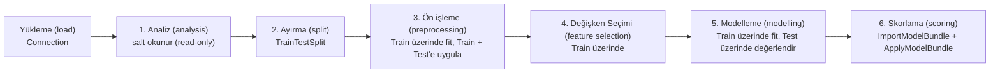

# koco Rehberi

koco ile ham bir tablodan skorlanmış (score) bir regresyon (regression) veya ikili sınıflandırma (binary classification) modeline nasıl ulaşılır.

- [Yaşam döngüsü (life cycle)](#yaşam-döngüsü-life-cycle)
- [Girdi gereksinimleri (input requirement)](#girdi-gereksinimleri-input-requirement)
- [Küçük örnekler](#küçük-örnekler)
- [Uçtan uca örnek (end-to-end example)](#uçtan-uca-örnek-end-to-end-example)
- [Fonksiyonların (function) döndürdükleri](#fonksiyonların-function-döndürdükleri)
- [Aykırı değer (outlier) planı oluşturma](#aykırı-değer-outlier-planı-oluşturma)
- [Fonksiyon referansı (function reference)](#fonksiyon-referansı-function-reference)
- [Algoritma anahtarları (algorithm key)](#algoritma-anahtarları-algorithm-key)
- [Rehberler](#rehberler)
- [Çıktı dosyaları ve mesajlar](#çıktı-dosyaları-ve-mesajlar)
- [SQL Server yapılandırması](#sql-server-yapılandırması)

---

## Yaşam döngüsü (life cycle)



| Adım | Amaç | Fonksiyonlar (function) |
|---|---|---|
| 1. Analiz (analysis) | Veriyi anlamak; boş değerleri (null), aykırı değerleri (outlier) ve veri hatalarını tespit etmek. Hiçbir şey değiştirilmez. | `DataSummary`, `DrawChart`, `AggregationReport`, `ColumnBinning`, `SampleBinning`, `CrossCheck`, `OutlierReport`, `OutlierCountByVariable`, `TargetDivergenceByColumn` |
| 2. Ayırma (split) | Herhangi bir şey fit edilmeden **önce** bir Test örneklemi (sample) ayırmak (split); böylece planlara hiçbir Test bilgisi sızmaz. | `TrainTestSplit`, `RepresentationReport` (Train popülasyonu (population) temsil ediyor mu?) |
| 3. Ön işleme (preprocessing) | Null → Aykırı değer (outlier) → WOE → Ölçekleme (scaling) sırasını izleyin, gerekmeyen adımları atlayın. WOE yalnızca ikili modeller (binary model) içindir. Planları Train üzerinde fit edin veya seçin, ardından Train, Test ve canlı ortam (production) verisine değiştirmeden uygulayın. | `ProfileNullColumns`, `FitNullPlan`, `ApplyNullPlan`, `ApplyOutlierPlan`, `FitWOEPlan`, `ApplyWOEPlan`, `FitScalingPlan`, `ApplyScalingPlan`, `ExportJson`, `ImportJson` |
| 4. Değişken Seçimi (feature selection) | Gereksiz ve bilgi taşımayan değişkenleri (feature) çıkarmak. | `Correlation`, `VIFReport`, `SelectModelFeatures`, `BackwardSelection` |
| 5. Modelleme (modelling) | Birkaç algoritma eğitmek, karşılaştırmak, Test üzerinde değerlendirmek. | `ModelRegistryGuide`, `CheckModellingInputs`, `RegressionModelling`, `ClassificationModelling`, `ApplyModel`, `CalculateModelPredictions`, `RegressionMetrics`, `ClassificationMetrics`, `MetricGuide`, `ExportModelArtifacts`, `ExportModelBundle` |
| 6. Skorlama (scoring) | Kaydedilmiş planları ve seçilen modeli yeni veriye uygulamak. | `ImportModelBundle`, `ApplyModelBundle` (veya tek tek `ImportJson`, `ApplyNullPlan`, `ApplyOutlierPlan`, `ApplyWOEPlan`, `ApplyScalingPlan`, `ApplyModel`, `CalculateModelPredictions`) |

Temel kurallar:

- Değişken seçimi (feature selection) ve modelleme (modelling) **sayısal (numeric)** değişkenler (feature) gerektirir. koco kategorik kodlama (categorical encoding) sağlamaz. Bu adımlardan önce metin sütunlarını başka bir araçla kodlayın veya `Features` listesinden açıkça çıkarın; skorlama (scoring) sırasında da aynı kodlamayı (encoding) kullanın.
- Her planı **yalnızca Train** üzerinde fit edin, ardından aynı planı Test'e ve canlı ortam (production) verisine uygulayın.
- Ön işleme (preprocessing) sırasını her yerde aynı tutun: Null → Aykırı değer (outlier) → WOE → Ölçekleme (scaling). Gerekmeyen adımları atlayın; WOE yalnızca ikili modeller (binary model) içindir ve çoğu zaman ek ölçekleme (scaling) gerektirmez.
- Ölçeklemeye (scaling) duyarlı algoritmalar (doğrusal modeller (linear model), SVM, KNN, MLP) ölçeklenmiş (scaled) değişkenler (feature) bekler; ağaç modelleri (tree model) ölçekleme (scaling) gerektirmez. Bir ölçekleme (scaling) yöntemi (method) seçmek için `ScalingMethodGuide` kullanın.
- `Apply*` fonksiyonları (function) girdi tablolarını değiştirmez. Değiştirilmeyen sütunlar girdiyle aynı belleği paylaşır, bu nedenle büyük tablolarda maliyetleri düşüktür.

---

## Girdi gereksinimleri (input requirement)

- Benzersiz sütun adlarına sahip, boş olmayan bir pandas DataFrame verin.
- `Target` sayısal (numeric) bir sütunu belirtir. Regresyon (regression), en az iki farklı boş olmayan hedef (target) değeri gerektirir. İkili sınıflandırma (binary classification) sayısal (numeric) `0` ve `1` gerektirir; Boolean hedefler (target) tam sayıya dönüştürülmelidir.
- `Features`, birbirinden farklı sayısal (numeric) sütun adlarından oluşan boş olmayan bir listedir ve `Target`'ı içermemelidir. Kimlik sütunlarını ve diğer uygun olmayan sütunları açıkça hariç tutun. `Features=None` olduğunda modelleme (modelling) `Target` dışındaki tüm sütunları kullanır.
- Hedef (target) ve değişken (feature) sütunları pozitif veya negatif sonsuz değer içermemelidir.
- Modelleme (modelling) fonksiyonları (function) hedefi (target) eksik olan satırları hariç tutar ve bir uyarı kaydeder. Diğer fonksiyonların (function) eksik değer (missing value) gereksinimleri farklı olabilir.
- Değişkenlerdeki (feature) eksik değerleri (missing value) değişken seçiminden (feature selection) önce ele alın. Modellemede (modelling) kalan NaN'lar yalnızca bunları destekleyen algoritmalar tarafından kabul edilir; `ModelRegistryGuide` ve `Log` çıktısını inceleyin.
- İkili eğitim verisi (binary training data) her iki sınıfı da içermelidir. Örneklem (sample) büyüklüğü gereksinimleri fonksiyona (function), modele ve ayırmaya (split) bağlıdır; kütüphanenin tamamı için tek bir minimum yoktur.
- Skorlama (scoring), eğitimdeki değişken (feature) adlarını ve aynı ön işlemeyi (preprocessing) gerektirir. Tahmin (prediction) için hedef (target) sütunu gerekli değildir.

---

## Küçük örnekler

Bu örnekler üretilmiş veri ve yalnızca temel bağımlılıkları (dependency) kullanır: veritabanı veya opsiyonel (optional) algoritma yoktur.
Önce kurulumu, ardından modelleme (modelling) örneklerinden birini çalıştırın. Veriyi yeniden üretmek için rastgele tohum değerini (random seed) ayarlayın.

### Ortak kurulum

```python
import numpy as np
import pandas as pd
import koco

Random = np.random.default_rng(1234)
Income = Random.uniform(2000, 8000, 240)
Age = Random.integers(20, 70, 240).astype(float)
Table = pd.DataFrame({
    "Income": Income,
    "Age": Age,
    "Amount": 0.2 * Income + 10 * Age + Random.normal(0, 50, 240),
    "Default": (Income + Random.normal(0, 1200, 240) < 4500).astype(int),
})
Table.loc[::12, "Income"] = np.nan
Features = ["Income", "Age"]
```

### Veritabanı olmadan regresyon (regression)

```python
Train, Test = koco.TrainTestSplit(
    Table, Target="Amount", TestSize=0.25, RandomState=1234,
)
NullPlan, Check = koco.FitNullPlan(Train, [("Income", "Median")])
Train = koco.ApplyNullPlan(Train, NullPlan, Verbose=False)
Test = koco.ApplyNullPlan(Test, NullPlan, Verbose=False)

Artifacts, Performance, Log, TrainData = koco.RegressionModelling(
    Train, Models=["LinearR"], Target="Amount", Features=Features,
    Split=False, RandomState=1234,
)
print(Log)
Prediction = koco.ApplyModel(Test, Artifacts["LinearR"])
print(koco.RegressionMetrics(Test["Amount"], Prediction))
```

`Prediction`, `Test` ile aynı indekse (index) sahip bir Series'tir. `Split=False` olduğu için burada
`Performance` Train'i tanımlar; son çağrı ayrılmış Test örneklemini (sample) değerlendirir.

### Veritabanı olmadan ikili sınıflandırma (binary classification)

```python
Train, Test = koco.TrainTestSplit(
    Table, Target="Default", TestSize=0.25, RandomState=1234, StratifyClasses=True,
)
NullPlan, Check = koco.FitNullPlan(Train, [("Income", "Median")])
Train = koco.ApplyNullPlan(Train, NullPlan, Verbose=False)
Test = koco.ApplyNullPlan(Test, NullPlan, Verbose=False)
ScalePlan = koco.FitScalingPlan(Train, {"Standardization": Features})
Train = koco.ApplyScalingPlan(Train, ScalePlan)
Test = koco.ApplyScalingPlan(Test, ScalePlan)

Artifacts, Performance, Log, TrainData = koco.ClassificationModelling(
    Train, Models=["LogisticC"], Target="Default", Features=Features,
    Split=False, RandomState=1234, Threshold=0.5,
)
print(Log)
Scores = koco.ApplyModel(Test, Artifacts["LogisticC"])
print(Scores.head())  # Probability ve Prediction
print(koco.ClassificationMetrics(Test["Default"], Scores["Probability"], Threshold=0.5))
```

Her örnek kendi planlarını kendi Train ayrımı (split) üzerinde fit eder. Açık bir değişken (feature) listesi, diğer
hedef (target) sütununu eğitimin dışında tutar.

---

## Uçtan uca örnek (end-to-end example)

Aşağıdaki iş akışı (workflow), SQL tabanlı daha büyük bir projeyi örnekler. Sayısal (numeric) `Income`, `Age` ve `Score`
sütunlarının, metin türünde bir `Segment` sütununun, atılacak bir `OldFlag` sütununun ve seçilen hedefin (target)
olduğunu varsayar. SQL kurulumu [SQL Server yapılandırması](#sql-server-yapılandırması) bölümünde açıklanmıştır.
Opsiyonel (optional) algoritmalar kendi ek paketlerini gerektirir; atlanan algoritmalar veya başarısız fit işlemleri için `Log` çıktısını inceleyin.

### Regresyon (regression)

```python
import pandas as pd
import koco

# 0. Yükleme (load)
Engine = koco.Connection("SERVER_A", "MyDatabase")
Table = pd.read_sql("SELECT * FROM dbo.Customer", Engine)
Target = "Amount"

# 1. Analiz (analysis) (tüm veri, salt okunur (read-only))
Summary = koco.DataSummary(Table)
ImagePath = koco.DrawChart(Table, BarColumn=Target, BinCount=30, SaveImage=True)   # PNG yolunu döndürür
koco.AggregationReport(Table, ["Segment"], Agg={Target: ["mean", "sum"]})
koco.ColumnBinning(Table, "Income", Bins=[0, 5000, 10000, 50000, 1e9])
koco.CrossCheck(Table, {"NegativeAge": "Age < 0", "MissingIncome": "Income IS NULL", "VipText": "Segment = 'A AND B'"})
koco.OutlierReport(Table, Method="IQR")
koco.OutlierCountByVariable(Table, "Income", Thresholds=[("Cap", 250000)])
koco.TargetDivergenceByColumn(Table, Target, "Segment")   # varsayılan (default): segment başına en az 1000 satır

# 2. Önce ayırma (split)
Train, Test = koco.TrainTestSplit(Table, Target, TestSize=0.3, StratifyBins=10)
koco.RepresentationReport(Table, Train)                   # Train tüm popülasyonu (population) temsil ediyor mu?

# 3. Ön işleme (preprocessing): Train üzerinde fit et, ikisine de uygula
koco.NullStrategyGuide(Print=True)
koco.ProfileNullColumns(Train)                      # FilePath="Data/NullAnalysis" ayrıca Excel'e de aktarır
NullPlan, NullCheck = koco.FitNullPlan(Train, [("Income", "Median"), ("Age", "Mean"), ("Score", "FixValue", 0), ("OldFlag", "Drop")])
Train = koco.ApplyNullPlan(Train, NullPlan)
Test  = koco.ApplyNullPlan(Test, NullPlan)

OutlierPlan = {"Columns": {"Income": ["U", 250000], "Age": ["L", 18]}}
Train = koco.ApplyOutlierPlan(Train, OutlierPlan)
Test  = koco.ApplyOutlierPlan(Test, OutlierPlan)

koco.ScalingMethodGuide(Print=True)
ScalePlan = koco.FitScalingPlan(Train, {"Standardization": ["Age"], "Robust": ["Income", "Score"]})
Train = koco.ApplyScalingPlan(Train, ScalePlan)
Test  = koco.ApplyScalingPlan(Test, ScalePlan)

koco.ExportJson(NullPlan, "Plans/NullPlan.json")
koco.ExportJson(OutlierPlan, "Plans/OutlierPlan.json")
koco.ExportJson(ScalePlan, "Plans/ScalingPlan.json")

# 4. Değişken seçimi (feature selection) (yalnızca Train)
Features = ["Income", "Age", "Score"]
CorrTable, Features, Dropped = koco.Correlation(Train[Features + [Target]], Target, Limit=0.7)
VIF, HighVIF = koco.VIFReport(Train[Features])
Selection = koco.SelectModelFeatures(Train, Features, Target, EliminationMethod="OnlyNoise")
Features = Selection.loc[Selection.Decision == "Select", "Feature"].tolist()

# 5. Modelleme (modelling): Train üzerinde fit et, dokunulmamış Test üzerinde değerlendir
ModelRegistry = koco.ModelRegistryGuide("Regression")
Artifacts, Performance, Log, TrainData = koco.RegressionModelling(
    Train, ["LinearR", "RidgeR", "RandFR", "LGBMR"], Target, Features=Features, Split=False,
)
TestPerformance = pd.DataFrame([
    {"AlgorithmName": Key, **koco.RegressionMetrics(Test[Target], koco.ApplyModel(Test, Artifact))}
    for Key, Artifact in Artifacts.items()
])

# 6. Yeni veriyi skorlama (scoring): tek bir dosya modeli ve planlarını taşır
BundlePath, BundleHash = koco.ExportModelBundle(
    Artifacts["RandFR"], Plans={"Null": NullPlan, "Outlier": OutlierPlan, "Scaling": ScalePlan}, FilePath="Models/AmountModel.joblib",
)
Bundle = koco.ImportModelBundle(BundlePath, ExpectedHash=BundleHash)     # canlı ortamda (production)
NewData = pd.read_sql("SELECT * FROM dbo.NewCustomer", Engine)
NewData["Prediction"] = koco.ApplyModelBundle(NewData, Bundle)           # Null -> Outlier -> WOE -> Scaling -> model
```

Planlar opsiyoneldir (optional) ve `ApplyModelBundle` yalnızca paketin içerdiklerini uygular. Modelin eğitim
değişkenlerini (feature) hazırlamak için gerçekten kullanılan her planı saklayın. Bir ağaç modeli (tree model) ölçekleme (scaling)
olmadan eğitilebilir; ancak ölçeklenmiş (scaled) veri üzerinde eğitildiyse, skorlama (scoring) paketinin de o ölçekleme (scaling) planına ihtiyacı vardır.
Paket kullanmadan, planları `ImportJson` ile yükleyin ve `ApplyNullPlan`, `ApplyOutlierPlan`, `ApplyWOEPlan`, `ApplyScalingPlan` ve `ApplyModel` fonksiyonlarını (function) bu sırayla kendiniz çağırın (fit etmediğiniz planları atlayın).

> Modelleri başka bir oturumda yeniden kullanmak için onları
> `koco.ExportModelArtifacts(Artifacts, "Amount models", "Models/Artifacts")` ile kaydedin ve birini
> `koco.ImportJoblib("Models/Artifacts/RandFR.joblib")` ile yükleyin. Yanlarına paket sürümlerini içeren bir `Manifest.json` yazılır.
> Artifacts sözlüğünün tamamını tek bir dosyaya kaydetmek için
> `koco.ExportJoblib(Artifacts, "Models/Artifacts.joblib")` kullanın ve
> `Artifacts = koco.ImportJoblib("Models/Artifacts.joblib")` ile yeniden yükleyin. Yalnızca güvenilir joblib dosyalarını yükleyin.

### İkili sınıflandırma (binary classification)

Yeni bir ayırma (split) kullanın ve planları ikili hedef (binary target) için yeniden fit edin; regresyon (regression) ayrımındaki (split) planlar
yeniden kullanılmaz. Bu örnek yalnızca sayısal (numeric) değişkenleri (feature) kullanır ve `Segment`'i modellemenin (modelling) dışında bırakır.

```python
Target = "Default"
Train, Test = koco.TrainTestSplit(Table, Target, TestSize=0.3, StratifyClasses=True)
Features = ["Income", "Age", "Score"]
NullPlan, NullCheck = koco.FitNullPlan(Train, [("Income", "Median"), ("Age", "Mean"), ("Score", "FixValue", 0), ("OldFlag", "Drop")])
Train = koco.ApplyNullPlan(Train, NullPlan)
Test = koco.ApplyNullPlan(Test, NullPlan)
OutlierPlan = {"Columns": {"Income": ["U", 250000], "Age": ["L", 18]}}
Train = koco.ApplyOutlierPlan(Train, OutlierPlan)
Test = koco.ApplyOutlierPlan(Test, OutlierPlan)
ScalePlan = koco.FitScalingPlan(Train, {"Standardization": Features})
Train = koco.ApplyScalingPlan(Train, ScalePlan)
Test = koco.ApplyScalingPlan(Test, ScalePlan)
Selection = koco.SelectModelFeatures(Train, Features, Target, ModelType="Binary")
Features = Selection.loc[Selection.Decision == "Select", "Feature"].tolist()

Artifacts, Performance, Log, TrainData = koco.ClassificationModelling(
    Train, ["LogisticC", "RandFC", "LGBMC"], Target, Features=Features, Split=False, ClassWeight="balanced",
)
Scores = koco.ApplyModel(Test, Artifacts["LGBMC"])                      # Probability + Prediction
koco.ClassificationMetrics(Test[Target], Scores["Probability"], Artifacts["LGBMC"]["Threshold"])
```

#### Opsiyonel (optional): WOE gruplama (binning) ve geriye doğru seçim (backward selection) (ikili modeller (binary model), örn. skor kartları (scorecard))

Bu, ikili iş akışının (workflow) alternatif bir koludur: null işleme ve aykırı değer (outlier) sınırlamasının hemen
ardından, ölçeklemeyi (scaling) fit etmeden veya uygulamadan ve yukarıdaki modelleme (modelling) bloğunu çalıştırmadan önce başlayın.

```python
# Null ve aykırı değer (outlier) planlarından sonra, ölçeklemeden (scaling) önce. Yalnızca Train üzerinde fit edin.
WOEPlan, Binning, IVTable = koco.FitWOEPlan(Train, Target, Features=Features, CoverBound=0.01, MeanDiffBound=0.01, IVBound=0.02)
Train = koco.ApplyWOEPlan(Train, WOEPlan)       # <Feature>_Bin ve <Feature>_WOE ekler
Test  = koco.ApplyWOEPlan(Test, WOEPlan)
koco.ExportJson(WOEPlan, "Plans/WOEPlan.json")

WOEFeatures = [f"{Column}_WOE" for Column in WOEPlan["Columns"]]
if not WOEFeatures:
    raise ValueError("WOE selected no features. Review IVTable and the binning settings before modelling.")
Kept, Steps = koco.BackwardSelection(Train, Target, Features=WOEFeatures, MaxPValue=0.05, ModelType="Binary")
Artifacts, Performance, Log, TrainData = koco.ClassificationModelling(Train, ["LogisticC"], Target, Features=Kept, Split=False)

koco.ExportModelBundle(Artifacts["LogisticC"], {"Null": NullPlan, "Outlier": OutlierPlan, "WOE": WOEPlan}, "Models/Scorecard.joblib")
```

- Gruplar, olay (event) satırlarının farklı değerlerinden oluşturulur ve her biri satırların `CoverBound` oranından fazlasını kapsayana ve komşu olay (event) oranları birbirinden `MeanDiffBound` değerinden fazla farklılaşana kadar birleştirilir. Boş değerler (null) kendi gruplarını oluşturur (çok küçük bir boş değer (null) grubu, olay (event) oranı en yakın olan gruba katılır).
- `IVTable` her değişkeni (feature) Information Value değeri ve `Selection` bilgisiyle listeler; `Binning` her grubu WOE, IV ve `BinClass` bilgisiyle listeler.
- Hiç olay (event) veya hiç olay-dışı (non-event) içermeyen bir grubun WOE değeri sonsuz olurdu; `ZeroAdjustment` (varsayılan (default) 0.5) sıfır sayımın yerine geçer, böylece plan sonlu ve JSON için güvenli kalır.
- WOE sütunları zaten karşılaştırılabilir bir ölçektedir, bu nedenle `ApplyWOEPlan` sonrasında genellikle bir ölçekleme (scaling) planı gerekmez.

---

## Fonksiyonların (function) döndürdükleri

Fonksiyon referansı (function reference) her public fonksiyon (function) için imzayı, tüm parametreleri (parameter) ve dönüş değerini (return value) verir.
İş akışı (workflow) boyunca kullanılan ana nesneler şunlardır:

| Nesne | Yapı | Sonraki adım |
|---|---|---|
| Null planı | `FitNullPlan`, `(Plan, Check)` döndürür: bir `Columns` dict'i içeren bir dict ve bir doğrulama DataFrame'i. | `Plan`'ı `ApplyNullPlan` ile uygulayın; `Check`'i inceleyin. |
| Ölçekleme (scaling) planı | `FitScalingPlan`, sütun başına `Strategy`, `Offset` ve `Scale` içeren bir dict döndürür. | `ApplyScalingPlan` |
| WOE çıktıları | `FitWOEPlan`, `(Plan, Binning, IVTable)` döndürür. Plan seçilen değişkenleri (feature) içerir; diğer iki çıktı DataFrame'dir. | `ApplyWOEPlan` öncesinde gruplamayı (binning) ve seçimi inceleyin. |
| Modelleme (modelling) çıktıları | Her iki modelleme (modelling) fonksiyonu (function) da `(Artifacts, Performance, Log, TrainData)` döndürür. | Tabloları inceleyin ve `Artifacts` içindeki bir girdiyle skorlayın (score). |
| Model paketi (model bundle) dışa aktarımı | `ExportModelBundle`, `(FilePath, Hash)` döndürür: bir `pathlib.Path` ve bir SHA-256 metni. | Hash'i ayrı saklayın ve içe aktarırken `ExpectedHash` olarak verin. |
| Model paketi (model bundle) içe aktarımı | `ImportModelBundle`, `Artifact`, `Plans` ve meta veri (metadata) içeren bir dict döndürür. | `ApplyModelBundle` |

### Modelleme (modelling) çıktıları ve artifact'ler

- `Artifacts`, başarıyla fit edilen algoritmalara göre anahtarlanmış bir dict'tir, örneğin
  `Artifacts["RandFR"]`. Kullanılamayan veya başarısız olan bir algoritma bulunmayabilir; bir girdiye
  erişmeden önce `Log`'u inceleyin.
- `Performance`, değerlendirilen her algoritma ve örneklem (sample) için bir satır içeren bir DataFrame'dir.
  `Split=False` ile yalnızca Train dahili olarak değerlendirilir; harici bir Test örneklemini (sample) ayrıca değerlendirin.
- `Log` doğrulama mesajlarını, uyarıları ve hataları kaydeder. Sütunları `Label`, `AlgorithmName`,
  `SampleName`, `Stage`, `Severity`, `Message` ve `SystemDate`'tir.
- `TrainData`, orijinal indekslerini (index) koruyan, `Features` ve `Target` sütunlarına sahip eğitim
  satırlarının tam kopyasını içerir.

Her artifact şunları içerir:

| Anahtar | Anlamı |
|---|---|
| `Model` | Fit edilmiş tahminleyici (estimator) |
| `ModelType` | `"Regression"` veya `"Binary"` |
| `Algorithm` | Tahminleyici (estimator) sınıf adı |
| `Features` | Eğitimde kullanılan değişken (feature) adlarının sıralı listesi |
| `Target` | Hedef (target) sütun adı |
| `Params` | Tahminleyiciye (estimator) verilen parametreler (parameter) |
| `Threshold` | İkili olasılık (probability) kesim noktası (cut-off); regresyon (regression) için `None` |
| `Label` | Çalıştırma etiketi (run label) |
| `TrainDate` | Eğitim zaman damgası (training timestamp) |
| `TrainSize` | Eğitim satırı sayısı |

`ImportModelBundle`, artifact'i ve planları `BundleFormat`, `KocoVersion`, `CreatedAt`, `Explanation`,
`Environment` ve `ModelSha256` ile birlikte döndürür. Sürüm kontrolleri ve hash'ler güvenilmeyen bir
dosyayı güvenli hâle getirmez: yalnızca güvenilir kaynaklardan gelen joblib dosyalarını ve paketleri yükleyin.

### Tahmin (prediction) çıktıları

| Fonksiyon (function) | Regresyon (regression) | İkili sınıflandırma (binary classification) |
|---|---|---|
| `ApplyModel` | `Prediction` adlı Series | `Probability` (sınıf 1) ve `Prediction` (0/1) içeren DataFrame |
| `ApplyModelBundle` | Saklanan planlar uygulandıktan sonra `ApplyModel` ile aynı | Saklanan planlar uygulandıktan sonra `ApplyModel` ile aynı |
| `CalculateModelPredictions` | İstenen girdi sütunları ve algoritma başına bir sütun, örn. `RandFR` | İstenen girdi sütunları ile `<Key>Probability` ve `<Key>Prediction`, örn. `LogisticCProbability` |

Tahmin (prediction) çıktıları girdi indeksini (index) korur. Bir null planı `DropRows` kullanıyorsa, `ApplyModelBundle`
yalnızca ön işleme (preprocessing) sonrasında kalan satırları döndürür.

## Aykırı değer (outlier) planı oluşturma

`FitOutlierPlan` diye bir fonksiyon (function) yoktur. Sınırları kullanıcı seçer ve planı bir dict olarak oluşturur.
`OutlierReport` istatistiksel adaylar sunar; bunun yerine minimum 18 yaş veya 250000 üst gelir sınırı
gibi alan (iş) kuralları da kullanılabilir.

Train'den türetilen bir üst sınır için bunu null işlemeden sonra ve WOE veya ölçeklemeden (scaling) önce çalıştırın:

```python
Outliers = koco.OutlierReport(Train[["Income"]], Method="IQR")
IncomeUpper = Outliers.loc[Outliers["Column"] == "Income", "UpperBound"].iloc[0]
if not np.isfinite(IncomeUpper):
    raise ValueError("Income has no finite upper bound; review the training data.")

OutlierPlan = {"Columns": {"Income": ["U", float(IncomeUpper)]}}
Train = koco.ApplyOutlierPlan(Train, OutlierPlan)
Test = koco.ApplyOutlierPlan(Test, OutlierPlan)
koco.ExportJson(OutlierPlan, "Plans/OutlierPlan.json")
```

Bu kod parçası küçük örneklerdeki `numpy as np` import'unu kullanır. Bir sınır seçmeden önce raporlanan
sayıları ve sınırları inceleyin; bir IQR sınırı bir adaydır, her aykırı değeri (outlier) sınırlamak için otomatik bir karar değildir.

- `"U"` seçilen sınırın üzerindeki değerleri sınırlar; `"L"` altındaki değerleri sınıra yükseltir.
- Her sütun girdisi bir yön ve bir sınır içerir. Bir sütunun her iki ucunu sınırlamak için ayrı alt ve
  üst planları tutarlı bir sırayla uygulayın; tek bir plan yinelenen sütun anahtarları içeremez.
- Veriden türetilen sınırları yalnızca Train üzerinde seçin ve Test ile yeni veride yeniden kullanın.
- `OutlierReport(..., Method=None)` her iki yöntemi (method) de `IQRUpperBound` gibi önekli adlarla raporlar;
  `Method="IQR"` belirtmek örnekte kullanılan `UpperBound`'u verir.
- `ApplyOutlierPlan` yeni bir DataFrame döndürür. Bu sonucu atayın; `Train` veya `Test` yerinde değiştirilmez.

---

## Fonksiyon referansı (function reference)

Tablolar hızlı bir genel bakış sunar. Tam imza, parametre (parameter) açıklamaları ve dönüş değeri (return value) için bir
fonksiyonun (function) ayrıntılarını genişletin. Zorunlu parametrelerin (parameter) varsayılan (default) değeri yoktur; `pd` pandas,
`np` numpy, `Path` `pathlib.Path`, `Callable` çağrılabilir bir tür ve `Engine` bir SQLAlchemy engine'idir.
Örnek çağrılar, her varsayılanı (default) tekrarlamak yerine o örnekle ilgili parametreleri (parameter) gösterir.
Referans tablolarındaki örnekler sıralı tek bir script değil, bağımsız kod parçalarıdır.
Aşağıdaki kurulum komutları PyPI'dan kurar. Kaynak klasörden (source folder) kurulumda `"koco-ml[sql]"` yerine
`".[sql]"` kullanın ve komutu `pyproject.toml` dosyasını içeren klasörden çalıştırın.

### general

| Fonksiyon (function) | Amaç | Örnek |
|---|---|---|
| `Connection` | SQL Server için bir SQLAlchemy engine döndürür. `python -m pip install "koco-ml[sql]"` gerektirir; bkz. [SQL Server yapılandırması](#sql-server-yapılandırması). | `Engine = koco.Connection("SERVER_A", "MyDatabase")` veya `koco.Connection(Config="sql.json")` |
| `RunFuncInSubSample` | DataFrame döndüren herhangi bir fonksiyonu (function) her grup için çalıştırır ve sonuçları alt alta birleştirir. | `koco.RunFuncInSubSample(Table, "Segment", koco.DataSummary)` |
| `ExportExcel` | Birden çok tabloyu ve grafik (chart) görselini tek bir Excel çalışma kitabına (workbook) yazar (`ExportExcel(Sheets, FilePath)`). Sayfalar önce doğrulanır (1–31 karakterlik adlar, sayfa başına en fazla 1.048.576 satır). | `koco.ExportExcel({"Summary": Summary, "Charts": [ImagePath, Table]}, "Report.xlsx")` |
| `ImportExcel` | Bir sayfayı (ad veya konum ile, varsayılan (default) olarak ilk sayfa) DataFrame olarak ya da `SheetName=None` ile tüm sayfaları dict olarak okur. `ExportExcel`'in yazdığı gibi ilk satır başlıktır. | `Table = koco.ImportExcel("Report.xlsx", "Summary")` |
| `ExportParquet` | Bir DataFrame'i Parquet olarak kaydeder. `pyarrow` gerektirir. | `koco.ExportParquet(Table, "Data/table.parquet")` |
| `ImportParquet` | Bir Parquet dosyasından DataFrame okur. | `Table = koco.ImportParquet("Data/table.parquet")` |
| `ExportJoblib` | Bir dict'i joblib olarak kaydeder. | `koco.ExportJoblib(Artifacts, "Artifacts.joblib")` |
| `ImportJoblib` | Güvenilir bir joblib dosyasından dict yükler. Güvenilir olmayan dosyaları yüklemek rastgele kod çalıştırabilir. | `Artifacts = koco.ImportJoblib("Artifacts.joblib")` |
| `ExportJson` | Fit edilmiş bir plan gibi bir dict'i JSON olarak kaydeder. NaN / inf değerleri reddedilir. | `koco.ExportJson(ScalePlan, "Plans/ScalingPlan.json")` |
| `ImportJson` | Bir JSON dosyasından dict yükler. Planları `Apply*` fonksiyonları (function) kendileri doğrular. | `ScalePlan = koco.ImportJson("Plans/ScalingPlan.json")` |
| `ExportModelArtifacts` | Her model artifact'ını joblib olarak, paket sürümlerini içeren bir JSON manifest ile birlikte bir dizine kaydeder (`DirPath`, varsayılan (default): geçerli klasör). | `koco.ExportModelArtifacts(Artifacts, "Amount models", "Models/Artifacts")` |
| `ExportModelBundle` | Bir modeli ve planlarını (`Null`, `Outlier`, `WOE`, `Scaling`, hepsi opsiyonel (optional)) tek bir joblib dosyasına kaydeder; yolu ve dosyanın SHA-256 değerini döndürür. | `FilePath, Hash = koco.ExportModelBundle(Artifacts["RandFR"], {"Scaling": ScalePlan}, "Models/Amount.joblib")` |
| `ImportModelBundle` | Bir model paketini (model bundle) yükler, dosyanın (`ExpectedHash`) ve içindeki modelin özet değerini (digest) kontrol eder ve sürüm farklılıkları hakkında uyarı verir. Yalnızca güvenilir dosyaları yükleyin. | `Bundle = koco.ImportModelBundle(FilePath, ExpectedHash=Hash)` |

<details>
<summary>Connection: parametreler (parameter) ve dönüş değeri (return value)</summary>

```text
Connection(
    Server: str | None = None,
    Database: str | None = None,
    Config: str | Path | None = None,
) -> Engine
```

**Parametreler (parameter)**

- `Server`: Sunucu adı. None, Config içindeki DefaultServer değerini kullanır.
- `Database`: Veritabanı adı. None, Config içindeki DefaultDatabase değerini kullanır.
- `Config`: JSON yapılandırma dosyasının yolu; None hiçbir dosya kullanmaz, bu nedenle Server ve Database zorunludur.

**Dönüş değeri (return value)**

İstenen veritabanına bağlı SQLAlchemy engine.

</details>

<details>
<summary>RunFuncInSubSample: parametreler (parameter) ve dönüş değeri (return value)</summary>

```text
RunFuncInSubSample(
    Table: pd.DataFrame,
    GroupColumn: str,
    Func: Callable[..., pd.DataFrame],
    **kwargs,
) -> pd.DataFrame
```

**Parametreler (parameter)**

- `Table`: Gruplara bölünecek kaynak tablo.
- `GroupColumn`: Alt grupları oluşturmak için kullanılan sütun.
- `Func`: Her alt grup ilk argüman olarak verilerek çağrılan fonksiyon (function); bir DataFrame döndürmelidir.
- `**kwargs`: Func'a iletilen ek anahtar kelime argümanları (keyword argument).

**Dönüş değeri (return value)**

İlk sütunu GroupColumn olan ve her alt grup için bir sonuç bloğu içeren birleştirilmiş DataFrame.

</details>

<details>
<summary>ExportExcel: parametreler (parameter) ve dönüş değeri (return value)</summary>

```text
ExportExcel(
    Sheets: dict[str, pd.DataFrame | str | list[pd.DataFrame | str]],
    FilePath: str | Path | None = None,
) -> Path
```

**Parametreler (parameter)**

- `Sheets`: Her değerin bir DataFrame, bir görsel yolu ya da bunların yukarıdan aşağıya yazılan bir listesi olduğu sayfa eşlemesi.
- `FilePath`: Çıktı Excel dosyası. None, geçerli klasöre &lt;yymmdd&gt;_ExportExcel.xlsx yazar; uzantılı bir yol dosyanın kendisidir; bir klasör (mevcut olan ya da uzantısız bir yol) varsayılan (default) dosya adını alır. Eksik klasörler oluşturulur.

**Dönüş değeri (return value)**

Yazılan çalışma kitabının (workbook) yolu.

</details>

<details>
<summary>ImportExcel: parametreler (parameter) ve dönüş değeri (return value)</summary>

```text
ImportExcel(
    FilePath: str | Path,
    SheetName: str | int | None = 0,
) -> pd.DataFrame | dict[str, pd.DataFrame]
```

**Parametreler (parameter)**

- `FilePath`: Girdi Excel dosyası (.xlsx veya .xlsm).
- `SheetName`: Okunacak sayfanın adı veya sıfırdan başlayan konumu; varsayılan (default) olarak ilk sayfa. None tüm sayfaları okur.

**Dönüş değeri (return value)**

İstenen sayfanın DataFrame'i ya da SheetName None olduğunda sayfa adı -&gt; DataFrame şeklinde bir dict.

</details>

<details>
<summary>ExportParquet: parametreler (parameter) ve dönüş değeri (return value)</summary>

```text
ExportParquet(
    Table: pd.DataFrame,
    FilePath: str | Path | None = None,
) -> Path
```

**Parametreler (parameter)**

- `Table`: Dışa aktarılacak DataFrame.
- `FilePath`: Çıktı dosyası. None, geçerli klasöre &lt;yymmdd&gt;_ExportParquet.parquet yazar; uzantılı bir yol dosyanın kendisidir; bir klasör (mevcut olan ya da uzantısız bir yol) varsayılan (default) dosya adını alır. Eksik klasörler oluşturulur.

**Dönüş değeri (return value)**

Yazılan dosyanın yolu; DataFrame indeksi (index) dışa aktarılmaz.

</details>

<details>
<summary>ImportParquet: parametreler (parameter) ve dönüş değeri (return value)</summary>

```text
ImportParquet(
    FilePath: str | Path,
) -> pd.DataFrame
```

**Parametreler (parameter)**

- `FilePath`: Girdi Parquet dosyasının yolu.

**Dönüş değeri (return value)**

Dosyadan okunan DataFrame.

</details>

<details>
<summary>ExportJoblib: parametreler (parameter) ve dönüş değeri (return value)</summary>

```text
ExportJoblib(
    Data: dict,
    FilePath: str | Path | None = None,
) -> Path
```

**Parametreler (parameter)**

- `Data`: Dışa aktarılacak dict.
- `FilePath`: Çıktı dosyası. None, geçerli klasöre &lt;yymmdd&gt;_ExportJoblib.joblib yazar; uzantılı bir yol dosyanın kendisidir; bir klasör (mevcut olan ya da uzantısız bir yol) varsayılan (default) dosya adını alır. Eksik klasörler oluşturulur.

**Dönüş değeri (return value)**

Yazılan dosyanın yolu.

</details>

<details>
<summary>ImportJoblib: parametreler (parameter) ve dönüş değeri (return value)</summary>

```text
ImportJoblib(
    FilePath: str | Path,
) -> dict
```

**Parametreler (parameter)**

- `FilePath`: Girdi joblib dosyasının yolu.

**Dönüş değeri (return value)**

Dosyadan okunan dict.

</details>

<details>
<summary>ExportJson: parametreler (parameter) ve dönüş değeri (return value)</summary>

```text
ExportJson(
    Data: dict,
    FilePath: str | Path | None = None,
) -> Path
```

**Parametreler (parameter)**

- `Data`: Dışa aktarılacak, JSON'a dönüştürülebilir dict.
- `FilePath`: Çıktı dosyası. None, geçerli klasöre &lt;yymmdd&gt;_ExportJson.json yazar; uzantılı bir yol dosyanın kendisidir; bir klasör (mevcut olan ya da uzantısız bir yol) varsayılan (default) dosya adını alır. Eksik klasörler oluşturulur.

**Dönüş değeri (return value)**

Yazılan dosyanın yolu.

</details>

<details>
<summary>ImportJson: parametreler (parameter) ve dönüş değeri (return value)</summary>

```text
ImportJson(
    FilePath: str | Path,
) -> dict
```

**Parametreler (parameter)**

- `FilePath`: ExportJson ile yazılmış bir dosyanın yolu.

**Dönüş değeri (return value)**

Dosyadan okunan dict; planları Apply fonksiyonları (function) kendileri doğrular.

</details>

<details>
<summary>ExportModelArtifacts: parametreler (parameter) ve dönüş değeri (return value)</summary>

```text
ExportModelArtifacts(
    ModelArtifacts: dict,
    Explanation: str = "Model Artifacts",
    DirPath: str | Path | None = None,
) -> Path
```

**Parametreler (parameter)**

- `ModelArtifacts`: Algoritma adlarından fit edilmiş artifact dict'lerine eşleme.
- `Explanation`: Manifest'e kaydedilen kısa açıklama.
- `DirPath`: Hedef dizin (destination directory). None geçerli klasörü kullanır; eksik klasör oluşturulur.

**Dönüş değeri (return value)**

Dizinin yolu. Dizin, her model için bir &lt;Algorithm&gt;.joblib dosyası ve Manifest.json içerir.

</details>

<details>
<summary>ExportModelBundle: parametreler (parameter) ve dönüş değeri (return value)</summary>

```text
ExportModelBundle(
    Artifact: dict,
    Plans: dict[str, dict] | None = None,
    FilePath: str | Path | None = None,
    Explanation: str = "Model Bundle",
) -> tuple[Path, str]
```

**Parametreler (parameter)**

- `Artifact`: RegressionModelling veya ClassificationModelling tarafından döndürülen ModelArtifacts dict'inin bir girdisi, örn. ModelArtifacts["RandFR"].
- `Plans`: "Null" (FitNullPlan), "Outlier" (aykırı değer (outlier) planı), "WOE" (FitWOEPlan) ve "Scaling" (FitScalingPlan) anahtarlarıyla verilen fit edilmiş planlar. Hepsi opsiyoneldir (optional); modelin ihtiyaç duymadığı planları dahil etmeyin.
- `FilePath`: Çıktı dosyası. None, geçerli klasöre &lt;yymmdd&gt;_ExportModelBundle.joblib yazar; uzantılı bir yol dosyanın kendisidir; bir klasör (mevcut olan ya da uzantısız bir yol) varsayılan (default) dosya adını alır. Eksik klasörler oluşturulur.
- `Explanation`: Model paketinde (model bundle) saklanan kısa açıklama.

**Dönüş değeri (return value)**

(FilePath, Sha256) demeti (tuple). Sha256, yazılan dosyanın özet değeridir (digest); dosyayı daha sonra ImportModelBundle(ExpectedHash=...) ile doğrulamak için saklayın.

</details>

<details>
<summary>ImportModelBundle: parametreler (parameter) ve dönüş değeri (return value)</summary>

```text
ImportModelBundle(
    FilePath: str | Path,
    ExpectedHash: str | None = None,
) -> dict
```

**Parametreler (parameter)**

- `FilePath`: Model paketi (model bundle) dosyasının yolu.
- `ExpectedHash`: ExportModelBundle tarafından döndürülen SHA-256 özet değeri (digest). Verilirse, herhangi bir şey yüklenmeden önce dosya doğrulanır.

**Dönüş değeri (return value)**

BundleFormat, KocoVersion, CreatedAt, Explanation, Environment, Plans (yalnızca dışa aktarılmış planlar), Artifact (fit edilmiş Model dahil model artifact'ı) ve ModelSha256 anahtarlarını içeren model paketi (model bundle) dict'i. Bunu ApplyModelBundle'a verin.

</details>

### analysis

| Fonksiyon (function) | Amaç | Örnek |
|---|---|---|
| `AggregationReport` | Bir tabloyu gruplar ve her grup için sayıları, payı ve seçilen toplulaştırmaları (aggregation) raporlar. | `koco.AggregationReport(Table, ["Segment"], Agg={"Income": ["mean"]}, Sort=[("Rate", "Desc")])` |
| `ColumnBinning` | Sayısal (numeric) bir sütunun dağılımını eşit genişlikte veya özel aralıklarda gösterir. | `koco.ColumnBinning(Table, "Age", Bins=[18, 30, 45, 65, 100])` |
| `SampleBinning` | Bir sütunu eşit büyüklükte gruplara (varsayılan (default) olarak ondalık dilimlere (decile)) ayırır ve her grup için min/maks değerleri verir. | `koco.SampleBinning(Table, "Income", Bins=10)` |
| `DataSummary` | Her sütunu tanımlar: tür, sayılar, boş değerler (null), yüzdelikler (percentile), sıfır/pozitif/negatif oranları. | `Summary = koco.DataSummary(Table)` |
| `CrossCheck` | SQL benzeri veri kalitesi kurallarına uyan satırları sayar. Tırnak içindeki metin asla yeniden yazılmaz; boşluk içeren sütun adlarını ters tırnak içine alın. | ``koco.CrossCheck(Table, {"BadAge": "Age < 0 OR Age > 120", "NoIncome": "`Net Income` IS NULL"})`` |
| `OutlierReport` | Her sayısal (numeric) sütun için IQR ve/veya Z-skoru (Z-score) aykırı değer (outlier) sınırlarını ve sayılarını raporlar. | `koco.OutlierReport(Table, Method="IQR")` |
| `OutlierCountByVariable` | Bir sütunun yüzdelik (percentile) (P1, P5, P95, P99) veya özel eşiklerinin (threshold) ötesinde kaç satır bulunduğunu yazdırır. | `koco.OutlierCountByVariable(Table, "Income", AddStats=True)` |
| `RepresentationReport` | Bir örneklemi (sample) (örn. Train) popülasyonla (population) sütun sütun karşılaştırır ve bir temsil gücü (representation power) `Rep` döndürür (1 = özdeş istatistikler). `Detail=True` her istatistiğin göreli farkını (relative difference) ekler. | `koco.RepresentationReport(Table, Train)` |
| `TargetDivergenceByColumn` | Hedef (target) dağılımının gruplar arasında farklılaşıp farklılaşmadığını (Kruskal-Wallis ile) test eder. | `koco.TargetDivergenceByColumn(Table, "Amount", "Segment")` |
| `DrawChart` | Histogram, çubuk, çizgi veya çubuk+çizgi grafiği (chart) çizer; `SaveImage=True` veya bir `FilePath` ile PNG kaydeder ve yolunu döndürür. | `ImagePath = koco.DrawChart(Table, BarColumn="Income", BinCount=30, SaveImage=True)` |

<details>
<summary>AggregationReport: parametreler (parameter) ve dönüş değeri (return value)</summary>

```text
AggregationReport(
    Table: pd.DataFrame,
    GroupColumns: list[str],
    Agg: dict[str, str | list[str] | tuple[str, ...]] | None = None,
    Sort: list[tuple[str, str | bool]] | None = None,
) -> pd.DataFrame
```

**Parametreler (parameter)**

- `Table`: Toplulaştırılacak (aggregation) kaynak tablo.
- `GroupColumns`: Gruplama (grouping) için kullanılan sütunlar.
- `Agg`: {"Amount": ["mean", "sum"]} gibi bir toplulaştırma (aggregation) eşlemesi; çıktı sütunları &lt;Func&gt;&lt;Column&gt; şeklinde adlandırılır, örn. meanAmount.
- `Sort`: Opsiyonel (optional) (Column, Direction) demetleri (tuple); Direction "Asc" / "Desc" ya da bir bool değerdir (True = artan). Sort verilmezse rapor Observation değerine göre azalan sırada dizilir.

**Dönüş değeri (return value)**

Gruplanmış sayıları, toplulaştırmaları (aggregation) ve oran değerlerini içeren DataFrame.

</details>

<details>
<summary>ColumnBinning: parametreler (parameter) ve dönüş değeri (return value)</summary>

```text
ColumnBinning(
    Table: pd.DataFrame,
    Column: str,
    Bins: int | tuple[float, float, int] | list[float] | None = None,
) -> pd.DataFrame
```

**Parametreler (parameter)**

- `Table`: Hedef (target) sütunu içeren kaynak tablo.
- `Column`: Gruplanacak sayısal (numeric) sütun.
- `Bins`: 10 eşit genişlikte grup için None, o sayıda eşit genişlikte grup için bir int, Start ile Stop arasında Count adet eşit genişlikte grup için bir (Start, Stop, Count) demeti (tuple) ya da kesin artan int / float sınırlardan oluşan bir liste. Demet (tuple) veya liste aralığının dışındaki değerler sayılmaz.

**Dönüş değeri (return value)**

Grup etiketlerini, gözlem sayılarını ve oranları içeren DataFrame. Sabit bir sütun tek bir grup olarak raporlanır.

</details>

<details>
<summary>SampleBinning: parametreler (parameter) ve dönüş değeri (return value)</summary>

```text
SampleBinning(
    Table: pd.DataFrame,
    Column: str,
    Bins: int = 10,
) -> pd.DataFrame
```

**Parametreler (parameter)**

- `Table`: Hedef (target) sütunu içeren kaynak tablo.
- `Column`: Örneklem (sample) tabanlı gruplara ayrılacak sütun.
- `Bins`: Oluşturulacak grup sayısı.

**Dönüş değeri (return value)**

Her grup için gözlem sayılarını, min ve maks değerleri ve oranları içeren DataFrame.

</details>

<details>
<summary>DataSummary: parametreler (parameter) ve dönüş değeri (return value)</summary>

```text
DataSummary(
    Table: pd.DataFrame,
) -> pd.DataFrame
```

**Parametreler (parameter)**

- `Table`: Özetlenecek kaynak tablo.

**Dönüş değeri (return value)**

Her sütun için bir satır içeren; tür, sayı, boş değer (null) ve dağılım metriklerini (metric) barındıran DataFrame. Sayısal olmayan (non-numeric) sütunlarda sayısal (numeric) istatistikler NaN olur.

</details>

<details>
<summary>CrossCheck: parametreler (parameter) ve dönüş değeri (return value)</summary>

```text
CrossCheck(
    Table: pd.DataFrame,
    CheckList: dict[str, str],
) -> pd.DataFrame
```

**Parametreler (parameter)**

- `Table`: Kuralların değerlendirilmesinde kullanılan kaynak tablo.
- `CheckList`: Kontrol adlarından SQL benzeri kural ifadelerine eşleme, örn. {"NegativeAge": "Age &lt; 0 AND Segment IS NOT NULL"}. Boşluk içeren sütun adlarını ters tırnak içine alın, örn. "`Net Income` IS NULL".

**Dönüş değeri (return value)**

Her kuralı ve ona uyan satır sayısını içeren DataFrame.

</details>

<details>
<summary>OutlierReport: parametreler (parameter) ve dönüş değeri (return value)</summary>

```text
OutlierReport(
    Table: pd.DataFrame,
    Method: str | None = None,
) -> pd.DataFrame
```

**Parametreler (parameter)**

- `Table`: Sayısal (numeric) sütunları içeren kaynak tablo.
- `Method`: Her iki yöntem (method) için None, 1.5x IQR kuralı için "IQR" veya |z| &gt; 3 kuralı için "ZScore".

**Dönüş değeri (return value)**

Her sayısal (numeric) sütun için sınırları, aykırı değer (outlier) sayısını ve aykırı değer (outlier) oranını içeren DataFrame.

</details>

<details>
<summary>OutlierCountByVariable: parametreler (parameter) ve dönüş değeri (return value)</summary>

```text
OutlierCountByVariable(
    Table: pd.DataFrame,
    VariableName: str,
    Thresholds: list[tuple[str, float]] | None = None,
    AddStats: bool = False,
) -> None
```

**Parametreler (parameter)**

- `Table`: Sayısal (numeric) sütunu içeren kaynak tablo.
- `VariableName`: Analiz (analysis) edilecek değişkenin (feature) adı.
- `Thresholds`: Kontrol edilecek (Label, Value) çiftleri, örn. [("Cap", 250000)].
- `AddStats`: P1, P5, P95, P99 (yüzdelikler (percentile)), Mode ve Median istatistiksel eşiklerini (threshold) ekler; Thresholds boş olduğunda bunlar her zaman eklenir.

**Dönüş değeri (return value)**

None. Sayılar ekrana yazdırılır.

</details>

<details>
<summary>RepresentationReport: parametreler (parameter) ve dönüş değeri (return value)</summary>

```text
RepresentationReport(
    Population: pd.DataFrame,
    Sample: pd.DataFrame,
    Statistics: list[str] | None = None,
    Detail: bool = False,
) -> pd.DataFrame
```

**Parametreler (parameter)**

- `Population`: Tüm popülasyonun (population) tablosu (örneğin tüm müşteriler).
- `Sample`: Örneklemin (sample) tablosu (örneğin Train).
- `Statistics`: Karşılaştırılacak DataSummary istatistikleri; REPRESENTATION_STATISTICS kümesinin bir alt kümesi. None; AvgValue, ModValue, MedValue, NullRate, ZeroRate, PositiveRate ve NegativeRate kullanır.
- `Detail`: True ise her istatistiğin göreli farkı (relative difference) da döndürülür.

**Dönüş değeri (return value)**

Rep değerine göre azalan sırada dizilmiş; ColumnName, Rep ve Detail True olduğunda her istatistik için bir sütun içeren DataFrame. Rep özdeş istatistikler için 1'dir ve istatistikler ayrıştıkça küçülür (negatif olabilir). Tüm sütunların ortalama (mean) Rep değeri, örneklemin (sample) temsil gücü (representation power) olarak yazdırılır.

</details>

<details>
<summary>TargetDivergenceByColumn: parametreler (parameter) ve dönüş değeri (return value)</summary>

```text
TargetDivergenceByColumn(
    Table: pd.DataFrame,
    Target: str,
    Divergence: str,
    Alpha: float = 0.05,
    EffectThreshold: float = 0.01,
    MinObservationSize: int = 1000,
) -> dict
```

**Parametreler (parameter)**

- `Table`: Hedef (target) ve gruplama (grouping) sütunlarını içeren kaynak tablo.
- `Target`: Dağılımları karşılaştırılan sayısal (numeric) hedef (target) sütun.
- `Divergence`: Karşılaştırılacak grupları tanımlayan sütun.
- `Alpha`: p-değeri (p-value) için 0 ile 1 arasında anlamlılık düzeyi (significance level).
- `EffectThreshold`: Pratik bir fark için gereken minimum epsilon-kare (epsilon-squared) etki büyüklüğü (effect size).
- `MinObservationSize`: Her grupta bulunması gereken minimum gözlem sayısı.

**Dönüş değeri (return value)**

Aşağıdaki anahtarları içeren dict:

- `Statistic`: Kruskal-Wallis H istatistiği.

- `PValue`: En az bu büyüklükte bir farkın tesadüfen ortaya çıkma olasılığı (probability).

- `EpsilonSquared`: Farkın etki büyüklüğü (effect size).

- `GroupCount`: Karşılaştırılan grup sayısı.

- `ObservationCount`: Testte kullanılan satır sayısı.

- `GroupSizes`: Her grup için gözlem sayısı.

- `Significant`: PValue &lt; Alpha.

- `Divergent`: Hem anlamlılık (significance) hem de etki büyüklüğü (effect size) koşulları sağlandığında True.

</details>

<details>
<summary>DrawChart: parametreler (parameter) ve dönüş değeri (return value)</summary>

```text
DrawChart(
    Table: pd.DataFrame,
    BarColumn: str | None = None,
    BinCount: int | None = None,
    LineColumn: str | None = None,
    IndexColumn: str | None = None,
    Title: str | None = None,
    FigureSize: tuple[float, float] = (5, 3),  # (11, 6) for presentations
    DPI: int = 100,  # 150 for presentations
    SaveImage: bool = False,
    FilePath: str | Path | None = None,
) -> str | None
```

**Parametreler (parameter)**

- `Table`: Grafik (chart) verilerini içeren kaynak tablo.
- `BarColumn`: Çubuk veya histogram olarak çizilen sütun.
- `BinCount`: Sayısal (numeric) histogramlar için kullanılan grup sayısı.
- `LineColumn`: Çizgi olarak çizilen sütun.
- `IndexColumn`: x ekseni olarak kullanılan opsiyonel (optional) sütun.
- `Title`: Opsiyonel (optional) grafik (chart) başlığı.
- `FigureSize`: Genişlik ve yükseklik olarak inç cinsinden şekil boyutu.
- `DPI`: Şekil çözünürlüğü.
- `SaveImage`: Grafiğin (chart) PNG dosyası olarak kaydedilip kaydedilmeyeceği; FilePath verildiğinde de kaydetme yapılır.
- `FilePath`: Görüntü dosyası. None, &lt;yymmdd&gt;_DrawChart.png dosyasını geçerli klasöre kaydeder; uzantılı bir yol dosyanın kendisidir; bir klasör (mevcut olan ya da uzantısız bir yol) varsayılan (default) dosya adını alır. Eksik klasörler oluşturulur.

**Dönüş değeri (return value)**

Kaydedilen PNG dosyasının yolu (ExportExcel içinde kullanılabilir) ya da grafik (chart) kaydedilmediğinde None. Grafik (chart) görüntülenir ve ardından şekli kapatılır.

</details>

### preprocessing

| Fonksiyon (function) | Amaç | Örnek |
|---|---|---|
| `ProfileNullColumns` | Her sütun için strateji (strategy) seçmeye yardımcı olmak üzere yalnızca boş değer (null) içeren sütunların profilini çıkarır. Yalnızca `FilePath` verildiğinde Excel'e aktarır (bir klasöre `<yymmdd>_NullProfile.xlsx` yazılır). | `koco.ProfileNullColumns(Train, FilePath="Data/NullAnalysis")` |
| `FitNullPlan` | Doldurma değerlerini Train üzerinde hesaplar ve yeniden kullanılabilir bir boş değer (null) planı ile bir doğrulama tablosu döndürür. Kurallar, herhangi bir çıktı yazdırılmadan önce doğrulanır. | `NullPlan, Check = koco.FitNullPlan(Train, [("Income", "Median")])` |
| `ApplyNullPlan` | Fit edilmiş bir boş değer (null) planını (silme / doldurma) herhangi bir tabloya uygular. `DropRows` indeksi (index) korur; `NaNHandling="Safe"` ayrıca `KeepNaN` sütunlarını da siler; `Verbose=False` çıktıyı susturur. | `Test = koco.ApplyNullPlan(Test, NullPlan)` |
| `FitWOEPlan` | Yalnızca ikili hedefler (binary target) içindir. Her sayısal (numeric) değişkeni (feature) gruplar, WOE / IV hesaplar ve IV değeri `IVBound` üzerinde olan değişkenlerden (feature) oluşan bir plan fit eder. Planı, tam gruplama (binning) tablosunu ve IV tablosunu döndürür. Yalnızca Train üzerinde fit edin. | `WOEPlan, Binning, IVTable = koco.FitWOEPlan(Train, "Default", Features=Features, CoverBound=0.01, MeanDiffBound=0.01, IVBound=0.02)` |
| `ApplyWOEPlan` | Planlanan değişkenler (feature) için herhangi bir tabloya `<Feature>_Bin` ve `<Feature>_WOE` sütunlarını ekler. Train'de görülmemiş boş değerler (null) Bin 0 ve WOE 0 alır. | `Test = koco.ApplyWOEPlan(Test, WOEPlan)` |
| `ApplyOutlierPlan` | Sabit limitlerin üzerindeki (`"U"`) veya altındaki (`"L"`) değerleri sınırlar. Bilinmeyen yöntemler (method) ve eksik sütunlar raporlanır ve atlanır. | `Train = koco.ApplyOutlierPlan(Train, {"Columns": {"Income": ["U", 250000]}})` |
| `FitScalingPlan` | Standardization / Normalization / Robust / MaxAbs parametrelerini (parameter) Train üzerinde fit eder (bkz. `ScalingMethodGuide`). | `ScalePlan = koco.FitScalingPlan(Train, {"Robust": ["Income"]})` |
| `ApplyScalingPlan` | Fit edilmiş bir ölçekleme (scaling) planını herhangi bir tabloya uygular. Girdiler doğrulanır (`Scale` 0 olmamalıdır) ve sütunlar sayısal (numeric) olmalıdır. | `Test = koco.ApplyScalingPlan(Test, ScalePlan)` |

<details>
<summary>ProfileNullColumns: parametreler (parameter) ve dönüş değeri (return value)</summary>

```text
ProfileNullColumns(
    Table: pd.DataFrame,
    FilePath: str | Path | None = None,
) -> pd.DataFrame
```

**Parametreler (parameter)**

- `Table`: Boş değerler (null) açısından incelenecek kaynak tablo.
- `FilePath`: None dışa aktarım yapmaz. Uzantılı bir yol (örn. "Data/NullAnalysis/Profile.xlsx") doğrudan Excel dosyasının kendisidir; bir klasöre (mevcut olan ya da uzantısız bir yol, örn. "Data/NullAnalysis") &lt;yymmdd&gt;_NullProfile.xlsx yazılır. Eksik klasörler oluşturulur.

**Dönüş değeri (return value)**

Boş değerlerle (null) ilgili istatistikleri içeren DataFrame; hiçbir sütun boş değer (null) içermiyorsa boştur.

</details>

<details>
<summary>FitNullPlan: parametreler (parameter) ve dönüş değeri (return value)</summary>

```text
FitNullPlan(
    Table: pd.DataFrame,
    NullPlan: list[tuple[str, str] | tuple[str, str, int | float | str]],
) -> tuple[dict, pd.DataFrame]
```

**Parametreler (parameter)**

- `Table`: Doldurma değerlerinin hesaplandığı eğitim tablosu (training table).
- `NullPlan`: [("A", "Drop"), ("B", "Median"), ("D", "FixValue", 10)] gibi kurallar; bkz. NullStrategyGuide.

**Dönüş değeri (return value)**

(FittedPlan, ColumnValidation) demeti (tuple).

- `FittedPlan`: JSON'a serileştirilebilir (serializable) dict {"Columns": {Column: {"Strategy", "Value"}}}.

- `ColumnValidation`: NullPlan'de yer almayan boş değerli (null) sütunları, Table'da bulunmayan plan sütunlarını (atlanır) ve Table'da boş değer (null) içermeyen plan sütunlarını (yine de fit edilir) listeleyen DataFrame.

</details>

<details>
<summary>ApplyNullPlan: parametreler (parameter) ve dönüş değeri (return value)</summary>

```text
ApplyNullPlan(
    Table: pd.DataFrame,
    Plan: dict,
    NaNHandling: str = "Full",
    Verbose: bool = True,
) -> pd.DataFrame
```

**Parametreler (parameter)**

- `Table`: Planın uygulandığı kaynak tablo.
- `Plan`: FitNullPlan tarafından üretilen veya ImportJson ile yüklenen boş değer (null) planı.
- `NaNHandling`: "Full" KeepNaN sütunlarına dokunmaz, "Safe" NaN içermeyen bir sonuç için bunları siler.
- `Verbose`: False ise hiçbir şey yazdırılmaz (skorlama (scoring) ve döngüler için kullanışlıdır).

**Dönüş değeri (return value)**

Planın uygulandığı yeni DataFrame; Table'ın kendisi değiştirilmez. DropRows orijinal indeksi (index) korur, böylece silinen satırlar geriye doğru izlenebilir.

</details>

<details>
<summary>FitWOEPlan: parametreler (parameter) ve dönüş değeri (return value)</summary>

```text
FitWOEPlan(
    Table: pd.DataFrame,
    Target: str,
    Features: list[str] | None = None,
    CoverBound: float = 0.01,
    MeanDiffBound: float = 0.01,
    IVBound: float = 0.02,
    ZeroAdjustment: float = 0.5,
) -> tuple[dict, pd.DataFrame, pd.DataFrame]
```

**Parametreler (parameter)**

- `Table`: Eğitim tablosu (training table); yalnızca Train üzerinde fit edin. Değişkenler (feature) sayısal (numeric) ve sonlu olmalı, Target ise boş değer (null) içermeden yalnızca 0 ve 1 içermelidir.
- `Target`: İkili hedef (binary target) sütunu.
- `Features`: Gruplanacak değişkenler (feature). None ise Target dışındaki tüm sütunlar kullanılır.
- `CoverBound`: Bir grubun kapsaması gereken minimum satır payı, 0 ile 1 arasında.
- `MeanDiffBound`: Komşu grupların olay (event) oranları arasındaki minimum fark.
- `IVBound`: IV değeri bu değerin üzerinde olan değişken (feature) seçilir.
- `ZeroAdjustment`: Bir grupta hiç olay (event) veya hiç olay-dışı (non-event) bulunmadığında, WOE ve IV sonlu kalsın diye 0 yerine kullanılan sayı. Sıfır sayı içermeyen gruplar bundan etkilenmez.

**Dönüş değeri (return value)**

(Plan, Binning, FeatureSelection) demeti (tuple).

- `Plan`: Yalnızca seçilen değişkenlere (feature) ait, JSON'a serileştirilebilir (serializable) {"Columns": {Feature: {"Cuts", "Bins", "WOE", "NullBin", "NullWOE"}}}. j. aralık (Cuts[j - 1], Cuts[j]] aralığını kapsar; ilk aralığın alt sınırı, son aralığın ise üst sınırı yoktur. ApplyWOEPlan ile uygulayın.

- `Binning`: Her değişkenin (feature) her grubu için ColumnName, Bin, LowerBound, UpperBound, Coverage, Rate, Freq, Target, NonTarget, BinFreq, BinTarget, BinNonTarget, BinPercTarget, BinPercNonTarget, WOE, IV ve BinClass içeren birer satır. Birleştirilmiş bir boş değer (null) grubu, katıldığı grubun Bin değeriyle ek bir satır olarak görünür.

- `FeatureSelection`: IV'ye göre azalan sırada sıralanmış ColumnName, IV ve Selection (IV &gt; IVBound ise 1).

</details>

<details>
<summary>ApplyWOEPlan: parametreler (parameter) ve dönüş değeri (return value)</summary>

```text
ApplyWOEPlan(
    Table: pd.DataFrame,
    Plan: dict,
) -> pd.DataFrame
```

**Parametreler (parameter)**

- `Table`: Planlanan değişkenleri (feature) içeren kaynak tablo.
- `Plan`: FitWOEPlan tarafından üretilen veya ImportJson ile yüklenen WOE planı.

**Dönüş değeri (return value)**

Orijinal sütunlara ek olarak planlanan her değişken (feature) için &lt;Feature&gt;_Bin ve &lt;Feature&gt;_WOE sütunlarını içeren yeni DataFrame; Table'ın kendisi değiştirilmez.

</details>

<details>
<summary>ApplyOutlierPlan: parametreler (parameter) ve dönüş değeri (return value)</summary>

```text
ApplyOutlierPlan(
    Table: pd.DataFrame,
    Plan: dict,
) -> pd.DataFrame
```

**Parametreler (parameter)**

- `Table`: Limitlerin uygulandığı kaynak tablo.
- `Plan`: {"Columns": {"Income": ["U", 250000], "Age": ["L", 18]}} gibi bir plan. "U" limitin üzerindeki değerleri sınırlar, "L" limitin altındaki değerleri limite yükseltir. Table'da bulunmayan sütunlar ve "U" / "L" dışındaki yöntemler (method) raporlanır ve atlanır.

**Dönüş değeri (return value)**

Limitlerin uygulandığı yeni DataFrame; Table'ın kendisi değiştirilmez.

</details>

<details>
<summary>FitScalingPlan: parametreler (parameter) ve dönüş değeri (return value)</summary>

```text
FitScalingPlan(
    Table: pd.DataFrame,
    Scaling: dict[str, list[str]],
) -> dict
```

**Parametreler (parameter)**

- `Table`: Ölçekleme (scaling) parametrelerinin (parameter) hesaplandığı eğitim tablosu (training table); değiştirilmez.
- `Scaling`: Ölçekleme (scaling) yöntemlerini (method) sütun adlarıyla eşleyen yapı, örn. {"Standardization": ["Age"], "Robust": ["Income"]}.

**Dönüş değeri (return value)**

Fit edilmiş plan {"Columns": {Column: {"Strategy", "Offset", "Scale"}}}. ApplyScalingPlan ile Train, Test veya canlı ortam (production) verisine uygulayın ve ExportJson ile kaydedin.

</details>

<details>
<summary>ApplyScalingPlan: parametreler (parameter) ve dönüş değeri (return value)</summary>

```text
ApplyScalingPlan(
    Table: pd.DataFrame,
    Plan: dict,
) -> pd.DataFrame
```

**Parametreler (parameter)**

- `Table`: Fit edilmiş planın uygulandığı kaynak tablo.
- `Plan`: FitScalingPlan tarafından üretilen veya ImportJson ile yüklenen ölçekleme (scaling) planı.

**Dönüş değeri (return value)**

Eğitim verisi (training data) üzerinde fit edilen parametrelerle (parameter) ölçeklenmiş (scaled) yeni DataFrame; Table değiştirilmez.

</details>

### feature_selection

| Fonksiyon (function) | Amaç | Örnek |
|---|---|---|
| `Correlation` | Yüksek korelasyonlu (correlation) değişken (feature) çiftlerini bulur ve hedefle (target) ilişkisi daha zayıf olanı siler (vektörize (vectorized), çok sayıda sütunda hızlı). | `Corr, Keep, Drop = koco.Correlation(Train[Features + [Target]], Target, Limit=0.7)` |
| `BackwardSelection` | Geriye doğru eleme (backward elimination): OLS (`ModelType="Regression"`) veya Logit (`"Binary"`) modelini yeniden fit eder ve tümü en fazla `MaxPValue` olana kadar en yüksek p-değerine (p-value) sahip değişkeni (feature) siler. Tutulan değişkenleri (feature) ve eleme adımlarını içeren bir tablo döndürür. `python -m pip install "koco-ml[stats]"` gerektirir. | `Kept, Steps = koco.BackwardSelection(Train, Target, Features=Features, MaxPValue=0.05, ModelType="Binary")` |
| `VIFReport` | Çoklu doğrusal bağlantıyı (multicollinearity) (VIF) ölçer ve `Threshold` (varsayılan (default) 10) üzerindeki değişkenleri (feature) listeler. Bool sütunlar 0/1 olarak ele alınır. | `VIF, High = koco.VIFReport(Train[Features], Threshold=5)` |
| `SelectModelFeatures` | Permütasyon önemi (permutation importance) + karşılıklı bilgi (mutual information) açısından rastgele gürültü sondalarını (noise probe) geçen değişkenleri (feature) tutar. `EliminationMethod="Combined"` harmanlanmış sıra skorunu (rank score) kullanır; `"OnlyNoise"` (daha katı) her iki ham sinyalin de en iyi sondayı geçmesini gerektirir. | `koco.SelectModelFeatures(Train, Features, Target, ModelType="Binary", EliminationMethod="OnlyNoise")` |

<details>
<summary>Correlation: parametreler (parameter) ve dönüş değeri (return value)</summary>

```text
Correlation(
    Table: pd.DataFrame,
    Target: str,
    Limit: float = 0.6,
    Method: str = "pearson",
    MethodT: str = "pearson",
) -> tuple[pd.DataFrame, list[str], list[str]]
```

**Parametreler (parameter)**

- `Table`: Yalnızca sayısal (numeric) değişken (feature) sütunlarını ve Target'ı içeren kaynak tablo.
- `Target`: Korelasyonlu (correlation) değişkenleri (feature) karşılaştırmak için kullanılan hedef (target) sütunu.
- `Limit`: Eleme için mutlak korelasyon (correlation) eşiği.
- `Method`: Değişkenden (feature) değişkene (feature) karşılaştırma için korelasyon (correlation) yöntemi (method) ("pearson", "spearman", "kendall").
- `MethodT`: Değişkenden (feature) hedefe (target) karşılaştırma için korelasyon (correlation) yöntemi (method).

**Dönüş değeri (return value)**

(CorrelationTable, RemainingColumns, EliminatedColumns) demeti (tuple).

</details>

<details>
<summary>BackwardSelection: parametreler (parameter) ve dönüş değeri (return value)</summary>

```text
BackwardSelection(
    Table: pd.DataFrame,
    Target: str,
    Features: list[str] | None = None,
    MaxPValue: float = 0.05,
    ModelType: str = "Regression",
) -> tuple[list[str], pd.DataFrame]
```

**Parametreler (parameter)**

- `Table`: Target'ı ve Features'ı içeren, boş değer (null) içermeyen kaynak tablo; model gerektiriyorsa çağırmadan önce değişkenleri (feature) ölçekleyin (scale) veya kodlayın.
- `Target`: Sayısal (numeric) hedef (target) sütunu; Binary için 0/1.
- `Features`: Aday sayısal (numeric) değişken (feature) adları. None ise Target dışındaki tüm sütunlar kullanılır.
- `MaxPValue`: Bir değişkenin (feature) kalabilmesi için sahip olabileceği en büyük p-değeri (p-value), 0 ile 1 arasında.
- `ModelType`: "Regression" (OLS) veya "Binary" (Logit).

**Dönüş değeri (return value)**

(RemainingFeatures, Steps) demeti (tuple).

- `RemainingFeatures`: p-değerine (p-value) göre en küçükten başlayarak sıralanmış tutulan değişkenler (feature); hiçbiri geçemezse boştur.

- `Steps`: Her eleme için Step, RemovedFeature, PValue ve Remaining (elemeden sonra kalan değişken (feature) sayısı) içeren birer satır.

</details>

<details>
<summary>VIFReport: parametreler (parameter) ve dönüş değeri (return value)</summary>

```text
VIFReport(
    Table: pd.DataFrame,
    Target: str | None = None,
    AutoClean: bool = False,
    Threshold: float = 10,
) -> tuple[pd.DataFrame, list[str]]
```

**Parametreler (parameter)**

- `Table`: Değişken (feature) sütunlarını içeren kaynak tablo; bool sütunlar 0/1 olarak ele alınır.
- `Target`: Rapordan hariç tutulan opsiyonel (optional) hedef (target) sütunu.
- `AutoClean`: True ise hesaplamadan önce sayısal olmayan (non-numeric) ve sabit sütunlar ile boş veya inf değer içeren satırlar silinir; False ise bunlardan biri bulunursa hata fırlatılır.
- `Threshold`: VIF değeri bu değerin üzerinde olan değişkenler (feature) yüksek VIF'li değişkenler (feature) olarak listelenir.

**Dönüş değeri (return value)**

(Report, HighVIFFeatures) demeti (tuple); HighVIFFeatures, VIF değeri Threshold üzerinde olan değişkenleri (feature) listeler.

</details>

<details>
<summary>SelectModelFeatures: parametreler (parameter) ve dönüş değeri (return value)</summary>

```text
SelectModelFeatures(
    Table: pd.DataFrame,
    Features: list[str],
    Target: str,
    Models: str | list[str] | None = None,
    Scoring: str | None = None,
    NNoiseFeatures: int = 10,
    CVFolds: int = 5,
    NRepeats: int = 10,
    RandomState: int = 1234,
    MinSelect: int = 1,
    ModelType: str = "Regression",
    EliminationMethod: str = "Combined",
    NJobs: int | None = -1,
) -> pd.DataFrame
```

**Parametreler (parameter)**

- `Table`: Aday değişken (feature) ve Target sütunlarını içeren, çağıran tarafından boş değerlerden (null) arındırılmış ve ölçeklenmiş (scaled) kaynak tablo; bu fonksiyon (function) veriyi dönüştürmez.
- `Features`: Değerlendirilecek aday sayısal (numeric) değişken (feature) adları.
- `Target`: Hedef (target) sütun adı; Regression için sayısal (numeric), Binary için 0/1.
- `Models`: Önemi skorlamak (scoring) için kullanılan, ModelType'a ait bir veya daha fazla kayıt anahtarı; birden fazla model kullanmak, kararı tek bir algoritmanın yanlılığının (bias) belirlemesi riskini azaltır. None, Regression için ("LassoR", "RandFR"), Binary için ("LogisticC", "RandFC") kullanır.
- `Scoring`: permutation_importance tarafından kullanılan sklearn skorlama (scoring) metni. None, Regression için "r2", Binary için "roc_auc" kullanır.
- `NNoiseFeatures`: Eleme referansı olarak kullanılan rastgele gürültü sondası (noise probe) sütunlarının sayısı. Daha fazla sonda daha katı ve daha kararlı bir referans sağlar: işe yaramaz bir değişken (feature) tüm sondaları yaklaşık 1 / (NNoiseFeatures + 1) olasılıkla (probability) geçer.
- `CVFolds`: Çapraz doğrulama katlarının (cross-validation) sayısı (Binary için tabakalandırılmış (stratification)).
- `NRepeats`: permutation_importance tarafından kat başına kullanılan karıştırma sayısı.
- `RandomState`: Gürültü üretimini, CV bölmelerini (fold) ve model fit etmeyi kontrol eden rastgele tohum (random seed).
- `MinSelect`: Tutulacak minimum değişken (feature) sayısı; gürültü referansını (noise baseline) geçen değişken (feature) sayısı bundan azsa, elenen değişkenlerden (feature) en iyi sıralananlar geri alınır.
- `ModelType`: "Regression" veya "Binary".
- `EliminationMethod`: "Combined", bir değişkeni (feature) CombinedScore değeri (her iki sinyalin ortalama yüzdelik sırası (percentile rank)) en iyi gürültü sondasının (noise probe) üzerindeyse seçer. "OnlyNoise" daha katıdır: permütasyon önemi (permutation importance) (0'ın üzerinde) ve karşılıklı bilginin (mutual information) her ikisi de ham değerlerde en iyi gürültü sondasının (noise probe) üzerinde olmalıdır.
- `NJobs`: Permütasyon öneminin (permutation importance) paralel iş sayısı; zaten paralel çalışan modeller NJobs'u kendileri için kullanır ve iç içe paralelliği önlemek için permütasyonu sıralı yapar.

**Dönüş değeri (return value)**

CombinedScore'a göre azalan sırada sıralanmış rapor DataFrame'i; referansların denetlenebilir kalması için hem gerçek Features satırlarını hem de gürültü sondası (noise probe) satırlarını (IsNoiseProbe ile işaretlenmiş) kapsar. Sütunlar: Feature, IsNoiseProbe, PermutationImportance, MutualInfo, CombinedScore (0-100 ölçeği), NoiseThreshold (en iyi sondanın CombinedScore değeri), PermutationNoiseThreshold, MutualInfoNoiseThreshold, Decision ("Select"/"Eliminate"/"Noise") ve Reason (yalnızca Eliminate/Noise satırları için doldurulur). İki grubu elde etmek için Decision üzerinden filtreleyin, örn. Report.loc[Report.Decision == "Select", "Feature"].

</details>

### modelling

| Fonksiyon (function) | Amaç | Örnek |
|---|---|---|
| `CheckModellingInputs` | Modelleme (modelling) girdilerini doğrular ve hangi algoritmaların çalışabileceğini listeler (otomatik olarak çağrılır). `**kwargs` tahminleyicilerinin (estimator) (XGB, LGBM) `ModelParams` içindeki yazım hataları uyarı olarak loglanır. | `Runnable, Log = koco.CheckModellingInputs(Train, ["RandFR"], Target)` |
| `TrainTestSplit` | Train/Test olarak böler; opsiyonel (optional) olarak hedef (target) gruplarına veya sınıflarına göre tabakalandırır (stratification). | `Train, Test = koco.TrainTestSplit(Table, Target, StratifyBins=10)` |
| `RegressionModelling` | Birden fazla regresyon (regression) algoritmasını eğitir ve artifact'leri, performansı ve bir log döndürür. | `koco.RegressionModelling(Train, ["RidgeR", "RandFR"], Target, Split=False)` |
| `ClassificationModelling` | Opsiyonel (optional) sınıf ağırlıkları (class weight) ve otomatik eşik (threshold) ile birden fazla ikili sınıflandırıcı (binary classifier) eğitir. | `koco.ClassificationModelling(Train, ["LogisticC", "LGBMC"], Target, ClassWeight="balanced")` |

<details>
<summary>CheckModellingInputs: parametreler (parameter) ve dönüş değeri (return value)</summary>

```text
CheckModellingInputs(
    Table: pd.DataFrame,
    Models: str | list[str],
    Target: str,
    Features: list[str] | None = None,
    Label: str | None = None,
    Split: dict | bool | None = None,
    ModelParams: dict[str, dict] | None = None,
    RandomState: int = 1234,
    ModelType: str = "Regression",
    ClassWeight: str | dict | None = None,
    Threshold: str | float = "auto",
) -> tuple[list[str], pd.DataFrame]
```

**Parametreler (parameter)**

- `Table`: Target ve Features sütunlarını içeren modelleme (modelling) tablosu.
- `Models`: ModelType'a ait kayıt defterindeki (registry) bir veya daha fazla anahtar.
- `Target`: Sayısal (numeric) hedef (target) sütun adı; Binary için yalnızca 0 ve 1 içermelidir.
- `Features`: Değişken (feature) sütun adları. None ise Target dışındaki tüm sütunlar kullanılır.
- `Label`: Log'a yazılan çalıştırma etiketi (run label).
- `Split`: False, Table'ın tamamını Train olarak kullanır; bir dict bölme (split) parametrelerini (parameter) sağlar. None, bölmeyi (split) varsayılanlarla (default) etkinleştirir. İzin verilen anahtarlar: TestSize, RandomState, Shuffle ve StratifyBins (Regression) veya StratifyClasses (Binary).
- `ModelParams`: Algoritmaya özgü parametreler (parameter), örn. {"RandFR": {"n_estimators": 500}}.
- `RandomState`: Destekleyen her algoritmaya uygulanan rastgele tohum (random seed).
- `ModelType`: "Regression" veya "Binary".
- `ClassWeight`: Yalnızca Binary. None, "balanced" veya {0: 1, 1: 5} gibi bir dict.
- `Threshold`: Yalnızca Binary. "auto" veya 0 ile 1 arasında bir sayı.

**Dönüş değeri (return value)**

(RunnableModels, Log) demeti (tuple).

- `RunnableModels`: Doğrulamayı geçen model anahtarları, istenen sırayla.

- `Log`: Label, AlgorithmName, SampleName, Stage, Severity, Message, SystemDate sütunlarına sahip DataFrame. Severity, atlanan algoritmalar için Error, diğer durumlarda Warning'dir.

</details>

<details>
<summary>TrainTestSplit: parametreler (parameter) ve dönüş değeri (return value)</summary>

```text
TrainTestSplit(
    Table: pd.DataFrame,
    Target: str,
    TestSize: float = 0.3,
    RandomState: int = 1234,
    Shuffle: bool = True,
    StratifyBins: int | None = None,
    StratifyClasses: bool = False,
) -> tuple[pd.DataFrame, pd.DataFrame]
```

**Parametreler (parameter)**

- `Table`: Bölünecek kaynak tablo.
- `Target`: Hedef (target) sütun; yalnızca StratifyBins veya StratifyClasses verildiğinde kullanılır.
- `TestSize`: Test'e ayrılan satırların payı, 0 ile 1 arasında bir float.
- `RandomState`: Karıştırmayı kontrol eden rastgele tohum (random seed).
- `Shuffle`: False ise satırların son TestSize payı (mevcut sırayla) Test olur; bu, zaman sıralı veriler için uygundur.
- `StratifyBins`: Yalnızca sürekli (continuous) Target. Her iki örneklemin (sample) benzer bir Target dağılımına sahip olması için bölmeyi (split) tabakalandırmada (stratification) kullanılan Target kantil (quantile) grubu sayısı. Shuffle=True gerektirir.
- `StratifyClasses`: Yalnızca kategorik (categorical) Target. True ise her iki örneklem (sample) aynı sınıf oranını korur. Shuffle=True gerektirir.

**Dönüş değeri (return value)**

Orijinal indeksi (index) koruyan (Train, Test) DataFrame demeti (tuple).

</details>

<details>
<summary>RegressionModelling: parametreler (parameter) ve dönüş değeri (return value)</summary>

```text
RegressionModelling(
    Table: pd.DataFrame,
    Models: str | list[str],
    Target: str,
    Features: list[str] | None = None,
    Label: str | None = None,
    Split: dict | bool | None = None,
    ModelParams: dict[str, dict] | None = None,
    RandomState: int = 1234,
) -> tuple[dict, pd.DataFrame, pd.DataFrame, pd.DataFrame]
```

**Parametreler (parameter)**

- `Table`: Temizlenmiş modelleme (modelling) tablosu; değiştirilmez.
- `Models`: Bir veya daha fazla Regression kayıt defteri (registry) anahtarı ("R" ile biten), örn. ["RidgeR", "RandFR"].
- `Target`: Sürekli (continuous) hedef (target) sütun adı. Target'ı boş (null) olan satırlar hariç tutulur.
- `Features`: Değişken (feature) sütun adları. None ise Target dışındaki tüm sütunlar kullanılır.
- `Label`: Farklı çalıştırmaları karşılaştırmak için kullanılan etiket. None ise "&lt;yymmdd&gt;_Run" kullanılır.
- `Split`: False, Table'ın tamamını Train olarak kullanır; bir dict, Table'ı TrainTestSplit ile Train / Test olarak böler (split). None, bölmeyi (split) varsayılanlarla (default) etkinleştirir. Dict anahtarları: TestSize, RandomState, Shuffle, StratifyBins. örn. {"TestSize": 0.25, "StratifyBins": 10}
- `ModelParams`: Kayıt defteri (registry) varsayılanlarını (default) geçersiz kılan algoritmaya özgü parametreler (parameter), örn. {"RandFR": {"n_estimators": 500}, "RidgeR": {"alpha": 10}}.
- `RandomState`: ModelParams veya Split içinde geçersiz kılınmadıkça, destekleyen her algoritmaya ve bölmeye (split) uygulanan rastgele tohum (random seed).

**Dönüş değeri (return value)**

(ModelArtifacts, Performance, Log, TrainData) demeti (tuple).

- `ModelArtifacts`: Algoritmaya göre anahtarlanmış dict; her girdi Model, ModelType, Algorithm, Features, Target, Params, Threshold (None), Label, TrainDate ve TrainSize içerir. Bir girdiyi ApplyModel'e verin.

- `Performance`: Her algoritma ve örneklem (sample) için bir satır; sütunlar: Label, AlgorithmName, SampleName, N, RMSE, MAE, MedAE, MAPE, WMAPE, R2, Bias, FitTimeSec.

- `Log`: Label, AlgorithmName, SampleName, Stage, Severity, Message, SystemDate sütunlarıyla hatalar ve uyarılar.

- `TrainData`: Modellerin fit edildiği satırların birebir kopyası (orijinal indeks (index), Features + Target); böylece çalıştırma, gelen satır sırasından bağımsız olarak yeniden üretilebilir.

</details>

<details>
<summary>ClassificationModelling: parametreler (parameter) ve dönüş değeri (return value)</summary>

```text
ClassificationModelling(
    Table: pd.DataFrame,
    Models: str | list[str],
    Target: str,
    Features: list[str] | None = None,
    Label: str | None = None,
    Split: dict | bool | None = None,
    ModelParams: dict[str, dict] | None = None,
    RandomState: int = 1234,
    ClassWeight: str | dict | None = None,
    Threshold: str | float = "auto",
) -> tuple[dict, pd.DataFrame, pd.DataFrame, pd.DataFrame]
```

**Parametreler (parameter)**

- `Table`: Temizlenmiş modelleme (modelling) tablosu; değiştirilmez.
- `Models`: Bir veya daha fazla Binary kayıt defteri (registry) anahtarı ("C" ile biten), örn. ["LogisticC", "RandFC"].
- `Target`: Yalnızca 0 ve 1 içeren ikili hedef (binary target) sütun. Target'ı boş (null) olan satırlar hariç tutulur.
- `Features`: Değişken (feature) sütun adları. None ise Target dışındaki tüm sütunlar kullanılır.
- `Label`: Farklı çalıştırmaları karşılaştırmak için kullanılan etiket. None ise "&lt;yymmdd&gt;_Run" kullanılır.
- `Split`: False, Table'ın tamamını Train olarak kullanır; bir dict, Table'ı TrainTestSplit ile Train / Test olarak böler (split) ve varsayılan (default) olarak Target'a göre tabakalandırır (stratification). None, bölmeyi (split) varsayılanlarla (default) etkinleştirir. Dict anahtarları: TestSize, RandomState, Shuffle, StratifyClasses. örn. {"TestSize": 0.25}
- `ModelParams`: Kayıt defteri (registry) varsayılanlarını (default) ve ClassWeight'i geçersiz kılan algoritmaya özgü parametreler (parameter), örn. {"RandFC": {"n_estimators": 500}, "LogisticC": {"C": 0.1}}.
- `RandomState`: ModelParams veya Split içinde geçersiz kılınmadıkça, destekleyen her algoritmaya ve bölmeye (split) uygulanan rastgele tohum (random seed).
- `ClassWeight`: Destekleyen her algoritmaya uygulanan dengesizlik yönetimi (imbalance handling). None (ağırlıklandırma yok), "balanced" (sınıf frekanslarıyla (class frequency) ters orantılı ağırlıklar) veya {0: 1, 1: 5} gibi bir dict. class_weight, scale_pos_weight (XGBoost) veya class_weights (CatBoost) parametresine (parameter) çevrilir; diğer algoritmalar bir uyarıyla ağırlıksız eğitilir.
- `Threshold`: "auto", her algoritma için Train üzerinde TPR - FPR'yi (Youden's J) maksimize eden kesim noktasını (cut-off) seçer; 0 ile 1 arasındaki bir sayı tüm algoritmalar için sabit kesim noktası (cut-off) olarak kullanılır.

**Dönüş değeri (return value)**

(ModelArtifacts, Performance, Log, TrainData) demeti (tuple).

- `ModelArtifacts`: Algoritmaya göre anahtarlanmış dict; her girdi Model, ModelType, Algorithm, Features, Target, Params, Threshold, Label, TrainDate ve TrainSize içerir. Bir girdiyi, opsiyonel (optional) olarak farklı bir Threshold ile ApplyModel'e verin.

- `Performance`: Her algoritma ve örneklem (sample) için bir satır; Label, AlgorithmName, SampleName, ClassificationMetrics çıktıları ve FitTimeSec içerir.

- `Log`: Label, AlgorithmName, SampleName, Stage, Severity, Message, SystemDate sütunlarıyla hatalar, uyarılar ve bilgi mesajları.

- `TrainData`: Modellerin fit edildiği satırların birebir kopyası (orijinal indeks (index), Features + Target); böylece çalıştırma, gelen satır sırasından bağımsız olarak yeniden üretilebilir.

</details>

### metrics

| Fonksiyon (function) | Amaç | Örnek |
|---|---|---|
| `RegressionMetrics` | Tahminler (prediction) için RMSE, MAE, MedAE, MAPE, WMAPE, R2 ve Bias. | `koco.RegressionMetrics(Test[Target], Prediction)` |
| `ClassificationMetrics` | Olasılıklar (probability) için AUC, Gini, KS, LogLoss, Brier ve karışıklık matrisi (confusion matrix) metrikleri (metric). | `koco.ClassificationMetrics(Test[Target], Scores["Probability"], 0.4)` |

<details>
<summary>RegressionMetrics: parametreler (parameter) ve dönüş değeri (return value)</summary>

```text
RegressionMetrics(
    YTrue: pd.Series | np.ndarray,
    YPred: pd.Series | np.ndarray,
) -> dict
```

**Parametreler (parameter)**

- `YTrue`: Gerçek hedef (target) değerleri.
- `YPred`: YTrue ile aynı sırada tahmin (prediction) edilen değerler.

**Dönüş değeri (return value)**

4 ondalığa yuvarlanmış metriklerden (metric) oluşan dict.

- `N`: Gözlem sayısı.

- `RMSE`: Kök ortalama kare hata (root mean squared error); büyük hataları daha ağır cezalandırır.

- `MAE`: Ortalama mutlak hata (mean absolute error).

- `MedAE`: Medyan mutlak hata (median absolute error); aykırı değerlere (outlier) karşı dayanıklıdır.

- `MAPE`: Oran olarak ortalama mutlak yüzde hata (mean absolute percentage error); YTrue != 0 olan satırlar üzerinden hesaplanır.

- `WMAPE`: Toplam mutlak hatanın toplam mutlak gerçek değere bölümü; sıfır hedeflerle (target) güvenle çalışır.

- `R2`: Target varyansının (variance) model tarafından açıklanan payı.

- `Bias`: (YPred - YTrue) ortalaması (mean); pozitif değer sistematik olarak fazla tahmin (prediction) anlamına gelir.

</details>

<details>
<summary>ClassificationMetrics: parametreler (parameter) ve dönüş değeri (return value)</summary>

```text
ClassificationMetrics(
    YTrue: pd.Series | np.ndarray,
    YProb: pd.Series | np.ndarray,
    Threshold: float = 0.5,
) -> dict
```

**Parametreler (parameter)**

- `YTrue`: Gerçek 0/1 hedef (target) değerleri.
- `YProb`: YTrue ile aynı sırada, sınıf 1 için tahmin (prediction) edilen olasılık (probability).
- `Threshold`: YProb'u 0/1 tahminlere (prediction) dönüştürmek için kullanılan olasılık (probability) kesim noktası (cut-off).

**Dönüş değeri (return value)**

Metriklerden (metric) oluşan dict; oranlar 4 ondalığa yuvarlanır. YTrue tek bir sınıf içerdiğinde AUC, Gini ve KS NaN olur.

- `N`: Gözlem sayısı.

- `TargetCount`: Sınıf 1 gözlem sayısı.

- `TargetRate`: Sınıf 1'in payı.

- `MeanProb`: Ortalama (mean) tahmin (prediction) olasılığı (probability); model kalibre olduğunda TargetRate'e yakındır.

- `ZeroPred`: Sınıf 0 gözlemlerinin ortalama (mean) tahmin (prediction) olasılığı (probability).

- `OnePred`: Sınıf 1 gözlemlerinin ortalama (mean) tahmin (prediction) olasılığı (probability).

- `AUC`: ROC eğrisi altındaki alan (area under the ROC curve); Threshold'dan bağımsız sıralama gücü.

- `Gini`: 2 * AUC - 1.

- `KS`: Sınıf 1 ve sınıf 0'ın kümülatif dağılımları (cumulative distribution) arasındaki en büyük fark.

- `LogLoss`: Olasılıkların (probability) çapraz entropisi (cross-entropy); düşük olması daha iyidir.

- `Brier`: Olasılıkların (probability) ortalama kare hatası (mean squared error); düşük olması daha iyidir.

- `Threshold`: Karışıklık matrisi (confusion matrix) metrikleri (metric) için kullanılan kesim noktası (cut-off).

- `TP, TN, FP, FN`: Karışıklık matrisi (confusion matrix) sayıları.

- `Precision`: 1 olarak tahmin (prediction) edilenlerden gerçekte 1 olanların payı.

- `Recall`: Gerçekte 1 olanlardan 1 olarak tahmin (prediction) edilenlerin payı.

- `F1`: Precision ve Recall'un harmonik ortalaması (harmonic mean).

</details>

### scoring

| Fonksiyon (function) | Amaç | Örnek |
|---|---|---|
| `ApplyModel` | Bir tabloyu model artifact'ı ile skorlar (score) (tahmin (prediction); Binary için olasılık (probability) + 0/1). Artifact `Model`, `ModelType` ve `Features` içermelidir; değişkenler (feature) mevcut ve sayısal (numeric) olmalıdır. | `koco.ApplyModel(Test, Artifacts["RandFR"])` |
| `CalculateModelPredictions` | Seçilen sütunları birden fazla modelin tahminleriyle (prediction) yan yana döndürür. | `koco.CalculateModelPredictions(Test, ["CustomerId", Target], Artifacts, Rename={"RandFR": "RF"})` |
| `ApplyModelBundle` | Ham bir tabloyu model paketi (model bundle) ile skorlar (score): önce saklanan planlar (Null, Outlier, WOE, Scaling), ardından model uygulanır. Null planındaki `DropRows`, girdiden daha az satır döndürebilir. | `Scores = koco.ApplyModelBundle(NewData, Bundle)` |

<details>
<summary>ApplyModel: parametreler (parameter) ve dönüş değeri (return value)</summary>

```text
ApplyModel(
    Table: pd.DataFrame,
    Artifact: dict,
    Threshold: float | None = None,
) -> pd.Series | pd.DataFrame
```

**Parametreler (parameter)**

- `Table`: Modelin eğitildiği Features'ı içeren, Train ile aynı planlarla ön işlenmiş tablo; Target zorunlu değildir.
- `Artifact`: RegressionModelling veya ClassificationModelling tarafından döndürülen ModelArtifacts dict'inin bir girdisi, örn. ModelArtifacts["RandFR"].
- `Threshold`: Yalnızca Binary modeller için. Sınıf 1 için olasılık (probability) kesim noktası (cut-off); None ise modelleme (modelling) sırasında artifact'ta saklanan eşik (threshold) kullanılır.

**Dönüş değeri (return value)**


- `Regression`: Table'ın indeksiyle (index) hizalı, Prediction adlı Series.

- `Binary`: Table'ın indeksiyle (index) hizalı, Probability ve Prediction sütunlarını içeren DataFrame.

</details>

<details>
<summary>CalculateModelPredictions: parametreler (parameter) ve dönüş değeri (return value)</summary>

```text
CalculateModelPredictions(
    Table: pd.DataFrame,
    OutputColumns: list[str],
    Artifacts: dict,
    Rename: dict[str, str] | None = None,
) -> pd.DataFrame
```

**Parametreler (parameter)**

- `Table`: Model değişkenlerini (feature) içeren girdi DataFrame'i.
- `OutputColumns`: Döndürülen DataFrame'e dahil edilecek sütunlar.
- `Artifacts`: Algoritma adlarından fit edilmiş regresyon (regression) veya sınıflandırma (classification) artifact'larına eşleme.
- `Rename`: Algoritma adlarından tahmin (prediction) sütunu öneklerine opsiyonel (optional) eşleme.

**Dönüş değeri (return value)**

İstenen girdi sütunlarını ve model tahminlerini (prediction) içeren DataFrame. Regression sütunları algoritma anahtarını (algorithm key) veya onun Rename değerini kullanır. Binary sütunları bu öneki Probability ve Prediction ile araya ayırıcı eklemeden birleştirir, örn. LogisticCProbability ve LogisticCPrediction. Girdi indeksi (index) korunur.

</details>

<details>
<summary>ApplyModelBundle: parametreler (parameter) ve dönüş değeri (return value)</summary>

```text
ApplyModelBundle(
    Table: pd.DataFrame,
    Bundle: dict,
    Threshold: float | None = None,
    Verbose: bool = False,
) -> pd.Series | pd.DataFrame
```

**Parametreler (parameter)**

- `Table`: Planların ve modelin ihtiyaç duyduğu sütunları içeren ham tablo; Target zorunlu değildir.
- `Bundle`: ImportModelBundle ile yüklenmiş model paketi (model bundle).
- `Threshold`: Yalnızca Binary modeller için. Sınıf 1 için olasılık (probability) kesim noktası (cut-off); None ise artifact'ta saklanan eşik (threshold) kullanılır.
- `Verbose`: True ise null planı kontrollerini yazdırır.

**Dönüş değeri (return value)**

ApplyModel ile aynıdır: skorlanan (score) satırların indeksiyle (index) hizalı, Prediction adlı bir Series (Regression) veya Probability ve Prediction sütunlarını içeren bir DataFrame (Binary).

</details>

### guides

| Fonksiyon (function) | Amaç | Örnek |
|---|---|---|
| `ModelRegistryGuide` | Algoritma anahtarlarını (algorithm key) ölçekleme (scaling) hassasiyeti, NaN toleransı ve kurulum durumuyla birlikte döndürür; sonuçları yazdırmak için `Print=True` verin. | `Registry = koco.ModelRegistryGuide("Regression", Print=True)` |
| `NullStrategyGuide` | Null stratejilerini (strategy) ve açıklamalarını İngilizce (`Language="ENG"`) veya Türkçe (`Language="TR"`) olarak döndürür. | `Guide = koco.NullStrategyGuide(Language="TR", Print=True)` |
| `ScalingMethodGuide` | Ölçekleme (scaling) yöntemlerini (method) karşılaştırır: ölçekleyici (scaler), sonuç aralığı, aykırı değer (outlier) hassasiyeti, en uygun kullanım (ENG / TR). | `koco.ScalingMethodGuide(Print=True)` |
| `MetricGuide` | Her metriğin (metric) aralığını, iyi yönünü, amacını ve yorumunu gösteren, iş birimlerine uygun tablo (ENG / TR). | `Guide = koco.MetricGuide("Binary", Language="TR", Print=True)` |

<details>
<summary>ModelRegistryGuide: parametreler (parameter) ve dönüş değeri (return value)</summary>

```text
ModelRegistryGuide(
    ModelType: str | None = None,
    Print: bool = False,
) -> pd.DataFrame
```

**Parametreler (parameter)**

- `ModelType`: Tek bir kaydı listelemek için "Regression" veya "Binary"; None ikisini de listeler.
- `Print`: True ise kaydı ve ölçekleme (scaling) / NaN hassasiyeti listelerini yazdırır.

**Dönüş değeri (return value)**

Her algoritma anahtarı (algorithm key) için bir satır içeren DataFrame; model tipini, tahminleyici (estimator) sınıfını, ölçeklenmiş (scaled) değişkenlere (feature) ihtiyaç duyup duymadığını, NaN değerleri kabul edip etmediğini ve paketinin kurulu olup olmadığını gösterir.

</details>

<details>
<summary>NullStrategyGuide: parametreler (parameter) ve dönüş değeri (return value)</summary>

```text
NullStrategyGuide(
    Language: str = "ENG",
    Print: bool = False,
) -> pd.DataFrame
```

**Parametreler (parameter)**

- `Language`: "ENG" (İngilizce) veya "TR" (Türkçe). Büyük/küçük harfe duyarsızdır (case-insensitive).
- `Print`: True ise rehberi ayrıca yazdırır.

**Dönüş değeri (return value)**

Her strateji (strategy) için bir satır içeren DataFrame: Strategy ve Description (Türkçede Strateji (strategy) ve Açıklama).

</details>

<details>
<summary>ScalingMethodGuide: parametreler (parameter) ve dönüş değeri (return value)</summary>

```text
ScalingMethodGuide(
    Language: str = "ENG",
    Print: bool = False,
) -> pd.DataFrame
```

**Parametreler (parameter)**

- `Language`: "ENG" (İngilizce) veya "TR" (Türkçe). Büyük/küçük harfe duyarsızdır (case-insensitive).
- `Print`: True ise rehberi ayrıca her yöntem (method) için okunabilir bir blok halinde yazdırır.

**Dönüş değeri (return value)**

Her yöntem (method) için bir satır içeren DataFrame: Method, Scaler, Result Range, Outlier Sensitivity, Best For ve Description (Türkçede sütun adları çevrilmiştir).

</details>

<details>
<summary>MetricGuide: parametreler (parameter) ve dönüş değeri (return value)</summary>

```text
MetricGuide(
    ModelType: str = "All",
    Language: str = "ENG",
    Print: bool = False,
) -> pd.DataFrame
```

**Parametreler (parameter)**

- `ModelType`: "Regression", "Binary" veya "All".
- `Language`: "ENG" (İngilizce) veya "TR" (Türkçe). Büyük/küçük harfe duyarsızdır (case-insensitive).
- `Print`: True ise rehberi ayrıca her metrik (metric) için okunabilir bir blok halinde yazdırır.

**Dönüş değeri (return value)**

Performans tablolarındaki sütun sırasıyla, her metrik (metric) için bir satır içeren DataFrame: Metric, Model Type, Value Range, Better When, Purpose & Significance, Interpretation.

</details>

---

## Algoritma anahtarları (algorithm key)

Regresyon (regression) anahtarları `R` ile, ikili sınıflandırma (binary classification) anahtarları `C` ile biter.

| Aile | Regresyon (regression) | İkili |
|---|---|---|
| Temel (baseline) | `DummyR` | `DummyC` |
| Doğrusal | `LinearR`, `RidgeR`, `LassoR`, `ElasticNetR`, `HuberR`, `BayesRidgeR` | `LogisticC` |
| Ağaç / Topluluk (ensemble) | `DecTR`, `RandFR`, `ExtraTreesR`, `GradBR`, `HistGBR`, `AdaBoostR`, `BaggingR` | `DecTC`, `RandFC`, `ExtraTreesC`, `GradBC`, `HistGBC`, `AdaBoostC`, `BaggingC` |
| Boosting (opsiyonel (optional)) | `XGBR`, `LGBMR`, `CatBoostR` | `XGBC`, `LGBMC`, `CatBoostC` |
| Diğer | `SVR`, `KNNR`, `MLPR` | `GaussNBC`, `SVC`, `KNNC`, `MLPC` |

`koco.ModelRegistryGuide()` kaydı bir DataFrame olarak döndürür; böylece onu programatik olarak inceleyebilir veya filtreleyebilirsiniz. Tabloyu ve ölçeklemeye (scaling) duyarlı ile NaN kabul etmeyen anahtar listelerini yazdırmak için `Print=True` kullanın.

## Rehberler

Her rehber bir DataFrame döndürür ve `Print=True` ile kendini yazdırabilir. Metin rehberleri `Language="ENG"` veya `Language="TR"` alır.

```python
koco.NullStrategyGuide(Language="TR", Print=True)   # hangi null stratejisinin (strategy) seçileceği
koco.ScalingMethodGuide(Print=True)          # hangi ölçekleme (scaling) yönteminin (method) seçileceği
koco.MetricGuide("Binary", Print=True)       # her metriğin (metric) nasıl yorumlanacağı
koco.ModelRegistryGuide("Regression")        # hangi algoritmaların bulunduğu ve neye ihtiyaç duydukları
```

## Çıktı dosyaları ve mesajlar

Her `Export*` fonksiyonu (function) (ve `SaveImage=True` ile `DrawChart`) `FilePath` için aynı kuralları izler:

| `FilePath` | Sonuç |
|---|---|
| `None` | Geçerli klasörde `<yymmdd>_<FunctionName>.<ext>`, örn. `261015_ExportExcel.xlsx` |
| `"Data/Report.xlsx"` (uzantısı var) | o dosya; eksik klasörler oluşturulur |
| `"Data/Reports"` (mevcut klasör veya uzantısız) | `Data/Reports/<yymmdd>_<FunctionName>.<ext>` |

Aynı adda bir dosya varsa güncellenir ve bir `❗` mesajı bunu bildirir. `DrawChart` ve `ProfileNullColumns`, `<yymmdd>_DrawChart.png` ve `<yymmdd>_NullProfile.xlsx` adlarını kullanır; `ProfileNullColumns` yalnızca `FilePath` verildiğinde dışa aktarır. `ExportModelArtifacts` bir dizin alır (`DirPath`, `None` = geçerli klasör).

Yazdırılan mesajlar tek bir sembol seti kullanır: `❗` dikkat gerektirir, `ℹ` bilgi, `✓` tamamlandı, `•` olağan ilerleme.

## SQL Server yapılandırması

Kütüphanede hiçbir sunucu adı saklanmaz. `Connection(Server=None, Database=None, Config=None)` iki şekilde çalışır:

```python
koco.Connection("SERVER_A", "MyDatabase")                    # dosya yok: adlar zorunludur
koco.Connection(Config="C:/Users/me/sql.json")                # DefaultServer / DefaultDatabase dosyadan
koco.Connection("SERVER_B", Config="C:/Users/me/sql.json")    # Server verildi; Database dosyadan
```

`Config`, opsiyonel (optional) bir JSON dosyasının yoludur (metin veya `Path`, `~` kullanılabilir). Varsayılan (default) bir konum ve
ortam değişkeni (environment variable) yoktur. Fonksiyona (function) verilen bir `Server` veya `Database` asla dosyadan okunmaz. Dosyayı proje
klasörünün ve herhangi bir deponun (repository) dışında tutun (macOS / Linux'ta `chmod 600`).

```json
{
  "DefaultServer": "SERVER_A",
  "DefaultDatabase": "MyDatabase",
  "DefaultDriver": "ODBC Driver 17 for SQL Server",
  "Trusted_Connection": "yes",
  "ODBCSYSINI": "/opt/homebrew/etc",
  "KRB5_CONFIG": "~/krb5.conf",
  "SPNs": {
    "SERVER_A": "MSSQLSvc/server-a.example.com:instance",
    "SERVER_B": "MSSQLSvc/server-b.example.com"
  }
}
```

- Her anahtar opsiyoneldir (optional). Dosya olmadan (veya anahtarlar olmadan) sürücü `ODBC Driver 17 for SQL Server`, `Trusted_Connection` ise `yes` olur.
- `SPNs`, bir sunucu adını hizmet asıl adıyla (service principal name) eşler. **Yalnızca macOS'ta** (Kerberos) gereklidir; bu nedenle bir Mac kullanıcısı sunucu için girdi içeren bir `Config` vermelidir; diğer sistemlerde yok sayılır.
- `ODBCSYSINI` (`odbcinst.ini` dosyasını içeren klasör) ve `KRB5_CONFIG` (`krb5.conf` dosyası) **yalnızca macOS / Linux'ta** kullanılır; bkz. [macOS / Linux: ODBC ve Kerberos kurulumu](#macos--linux-odbc-ve-kerberos-kurulumu).
- `Config` olmadan hem `Server` hem `Database` verilmelidir. `Config` ile, verilmeyen değer dosyada `DefaultServer` / `DefaultDatabase` olarak bulunmalıdır. Dosya bulunamazsa `FileNotFoundError` ve bu örneği içeren bir mesaj fırlatılır.
- `Connection`, `sql` ek paketini (`python -m pip install "koco-ml[sql]"`) ve *ODBC Driver 17 for SQL Server*'ı gerektirir. macOS'ta ayrıca geçerli bir Kerberos bileti gerekir (`kinit`; `klist` ile kontrol edin).
- Sunucu adları, SPN'ler ve veritabanı adları veritabanı yöneticileri tarafından sağlanır; aynı JSON dosyası birden fazla kullanıcı tarafından paylaşılabilir.

### macOS / Linux: ODBC ve Kerberos kurulumu

Bu sistemlerde bağlantı unixODBC ve Kerberos üzerinden kurulur. JSON dosyası sürücünün adını verir; ancak sistemin
sürücünün nerede kayıtlı olduğunu ve Kerberos ayarlarının nerede olduğunu da bilmesi gerekir:

1. Sürücüyü kurun. Homebrew ile macOS'ta: `brew tap microsoft/mssql-release https://github.com/Microsoft/homebrew-mssql-release`
   ardından `brew install msodbcsql17` (bu komut unixODBC'yi de kurar).
2. Sürücünün kayıtlı olduğunu kontrol edin: `odbcinst -j` unixODBC'nin okuduğu `odbcinst.ini` dosyasını gösterir;
   `odbcinst -q -d` çıktısında `ODBC Driver 17 for SQL Server` yer almalıdır.
3. Kurumunuzun `krb5.conf` dosyasını (realm ve KDC ayarları) IT veya veritabanı yöneticilerinden alın.
   Varsayılan (default) konum `/etc/krb5.conf`'tur.
4. `kinit kullanici@REALM` ile bilet alın ve `klist` ile kontrol edin.

Sürücü varsayılan (default) konumda bulunamıyorsa (örneğin conda ortamındaki pyodbc kendi unixODBC'sini kullandığı için)
veya `krb5.conf` `/etc` altında değilse yolları JSON dosyasına ekleyin:

| Anahtar | Değer | Eksik olduğunda tipik hata |
|---|---|---|
| `ODBCSYSINI` | `odbcinst.ini` dosyasını içeren klasör (Homebrew: Apple silicon'da `/opt/homebrew/etc`, Intel'de `/usr/local/etc`) | `Can't open lib 'ODBC Driver 17 for SQL Server' : file not found` |
| `KRB5_CONFIG` | `krb5.conf` dosyasının yolu | `Cannot generate SSPI context` / GSSAPI hataları |

- `~` kullanılabilir; göreli (relative) bir yol JSON dosyasının klasörüne göre alınır.
- `Connection` bunları ilk bağlantıdan önce ortam değişkeni (environment variable) olarak atar ve `odbcinst.ini` / `krb5.conf` dosyalarının var olduğunu kontrol eder.
- Zaten atanmış bir değişken (örneğin `~/.zshrc` içinde) korunur; değeri farklıysa bir `ℹ` mesajı yazdırılır.
- unixODBC değişkenleri süreç (process) başına bir kez okur. Değiştirdikten sonra notebook kernel'ini yeniden başlatın.
- Windows'ta bu iki anahtar yok sayılır; bu nedenle aynı dosya Windows kullanıcılarıyla paylaşılabilir.
